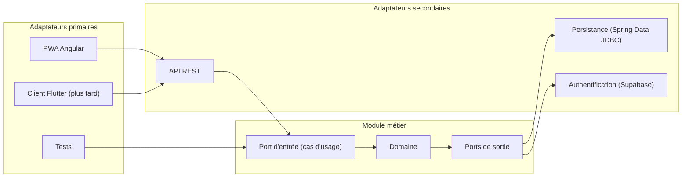

# ADR-0005 : Architecture hexagonale en monolithe modulaire

- **Statut** : Acceptée
- **Date** : 2026-11-20

## Contexte

Le projet suit une approche **TDD** et une **architecture hexagonale** sur tous ses composants, avec une démarche pédagogique. Il y aura plusieurs clients (PWA, puis Flutter). Le développeur est seul. La question s'est posée d'adopter des micro-services pour la scalabilité horizontale.

## Options étudiées

1. **Micro-services** : déploiement indépendant et mise à l'échelle par service. Mais plusieurs déploiements, appels réseau, cohérence des données répartie, tests plus lourds : coût élevé pour une personne seule, sans bénéfice à quelques centaines d'utilisateurs.
2. **Monolithe non structuré** : simple au départ, mais le couplage rend les évolutions et les tests difficiles.
3. **Monolithe modulaire hexagonal** : un seul déploiement, divisé en modules métier aux frontières nettes, chacun organisé en ports et adaptateurs.

## Décision

Nous construisons un **monolithe modulaire** en **architecture hexagonale**.

- Modules métier initiaux : `catalog` (bibliothèque d'exercices), `programs` (programmes de séance), `sessions` (suivi de séance et historique), `users` (utilisateurs).
- Dans chaque module : le **domaine** (aucune dépendance au cadre), les **ports** (interfaces), les **cas d'usage**, et les **adaptateurs** (API REST, persistance, authentification).
- Le back-end est **sans état** (l'authentification passe par un jeton) : il peut être répliqué derrière un répartiteur de charge sans micro-services.
- Les frontières sont **vérifiées par des tests ArchUnit**.

## Conséquences

- Le domaine se teste sans base de données ni cadre web, ce qui sert directement le TDD.
- Remplacer un adaptateur (persistance, fournisseur d'authentification, hébergement) ne touche pas au domaine.
- Le futur client Flutter est un adaptateur primaire de plus.
- Extraire un module en service séparé reste possible plus tard, **justifié par des mesures**, grâce aux frontières nettes.
- Prix à payer : plus de classes et de conversions (objets du domaine, DTO, entités de persistance).

## Pour aller plus loin

- Alistair Cockburn, « Hexagonal architecture » (ports et adaptateurs).
- ADR-0004 (langage et cadre), ADR-0006 (persistance).
