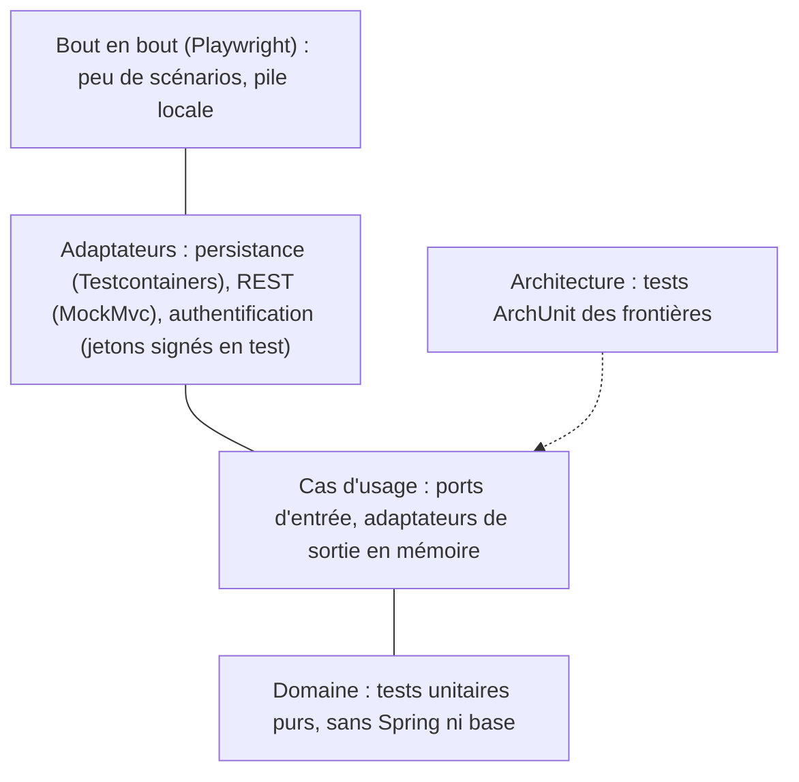

# ADR-0010 : Stratégie de test (TDD, pyramide, contrat d'API)

- **Statut** : Acceptée
- **Date** : 2026-11-20

## Contexte

Le projet suit une approche **TDD** et une architecture hexagonale (ADR-0005), avec une démarche pédagogique. Il aura plusieurs clients (PWA, puis Flutter, ADR-0002), et le développeur est seul : les tests sont le principal filet de sécurité et la documentation vivante du comportement.

## Options étudiées

**Approche TDD**
1. **Outside-in** : on écrit d'abord un test d'acceptation au niveau d'un cas d'usage (port d'entrée), puis on descend vers le domaine. Cohérent avec l'hexagonal, force à penser le comportement avant la technique.
2. **Inside-up** : on commence par le domaine, puis on remonte. Plus simple à apprendre, mais risque de construire des briques inutiles.

**Contrat d'API entre les clients et le back-end**
1. **OpenAPI d'abord** : la spécification est écrite en premier, vérifiée par des tests de contrat, et sert à générer les clients.
2. **Spécification générée depuis le code** : rapide au départ, mais le contrat devient un effet de bord de l'implémentation.

**Tests de mutation** (PIT côté Kotlin, Stryker côté Angular)
1. **Pas au démarrage** : ils sont lents et supposent du code existant à muter.
2. **Dès le début.**

## Décision

**Cycle** : Red → Green → Refactor, avec une approche **outside-in**. Les commits suivent les étapes significatives du cycle.

**Pyramide de tests**

- **Domaine** : tests unitaires purs, très nombreux et très rapides.
- **Cas d'usage** : tests d'acceptation sur les ports d'entrée, avec des adaptateurs de sortie en mémoire.
- **Adaptateurs** : intégration ciblée (PostgreSQL via Testcontainers, REST via MockMvc, jetons signés en test pour l'authentification).
- **Architecture** : tests **ArchUnit** vérifiant les frontières hexagonales.
- **Bout en bout** : quelques scénarios **Playwright** sur la pile locale (CLI Supabase).

**Outils back-end** : JUnit 5, MockK, AssertJ. La couverture est mesurée avec JaCoCo comme **indicateur**, pas comme objectif.

**Contrat d'API** : **OpenAPI d'abord**. La spécification est la source de vérité ; des tests de contrat côté back-end la vérifient, et les clients (Angular, puis Flutter) en sont générés ou validés.

**Tests de mutation** : **pas au démarrage**. Ils seront ajoutés après les premiers incréments, une fois le socle stable.

**Outil de test du front** (Jasmine/Karma, Jest ou Vitest) : **ouvert volontairement**. Le défaut d'Angular a évolué récemment ; le choix sera arrêté, et cet ADR complété, au moment de générer le projet Angular.

## Conséquences

- Le domaine se teste sans base ni cadre web, ce qui garde la boucle de TDD très courte.
- Les adaptateurs de sortie en mémoire servent à la fois aux tests et de référence de comportement des ports.
- Un contrat OpenAPI explicite protège le futur client Flutter et rend les évolutions d'API visibles en revue.
- Le démarrage demande plus de rigueur (spécification avant implémentation, test d'acceptation avant le code), en échange d'un code guidé par le comportement.
- À réexaminer : l'ajout des tests de mutation après les premiers incréments ; l'outil de test du front au moment de la génération du projet.

## Pour aller plus loin

- Kent Beck, *Test-Driven Development: By Example*.
- Steve Freeman et Nat Pryce, *Growing Object-Oriented Software, Guided by Tests* (approche outside-in).
- ADR-0005 (architecture hexagonale), ADR-0002 (clients multiples).
