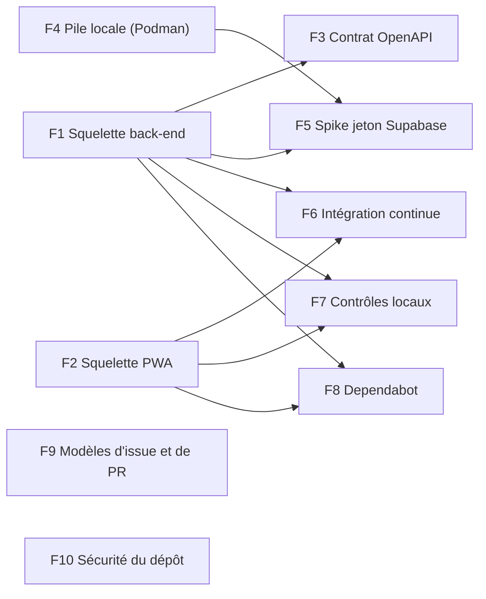

# Lot 1 : issues de fondation

> **Statut : archive de la revue statique du 2026-11-20. Les 10 issues ont été créées sur GitHub (#68 à #77).**
> **GitHub est la source de vérité** : ce fichier n'est pas synchronisé avec les issues. Il conserve la grille de revue et les décisions prises, et les références `F1`, `F2`, etc. du texte correspondent aux numéros indiqués dans les titres ci-dessous.

Métadonnées communes : label `Technical Recit`, Epic `Core technique`, jalon `v0.1.0 - Fondations`, statut initial `New`.

## Décisions prises en revue

| Sujet | Décision |
|---|---|
| Outil de build du back-end | Gradle (Kotlin DSL) |
| Emplacement du contrat OpenAPI | Dossier `contracts/` à la racine |
| Moteur de conteneurs | **Podman**, avec Docker comme solution de repli si l'essai échoue |
| Versions | Versions à support long (LTS) pour Java et Node.js ; dernière version stable compatible pour Kotlin, Gradle, Spring Boot et Angular |
| Persistance et sécurité dans F1 | Ajoutées plus tard, par les issues qui en ont besoin |
| Contrôles qualité | Sur le poste avant poussée (F7), puis intégration continue sur *pull requests* seulement (F6) |
| Règle de protection de `master` | Reportée |
| Bot de dépendances | Dependabot (F8) |

## Grille de revue statique (à appliquer à chaque issue)

Type de revue proposé : **walkthrough** (l'auteur présente, le relecteur interroge).

| # | Critère | Question à se poser |
|---|---|---|
| 1 | Clarté | Le titre et la description sont-ils compréhensibles sans contexte ? Y a-t-il des termes ambigus ? |
| 2 | Valeur | Pourquoi cette issue existe-t-elle ? Quel besoin ou quel risque traite-t-elle ? |
| 3 | Critères d'acceptation | Sont-ils vérifiables de façon objective (Given/When/Then ou liste) ? |
| 4 | Testabilité | Peut-on écrire le test avant le code ? |
| 5 | Taille (INVEST) | Indépendante, négociable, valuable, estimable, **petite**, testable ? |
| 6 | Dépendances | Sont-elles explicites et sans cycle ? |
| 7 | Cohérence | Respecte-t-elle les ADR ? Impose-t-elle un nouvel ADR ? |
| 8 | Périmètre | Le « hors périmètre » est-il explicite ? |

## Définition de terminé (commune)

- Tests écrits **avant** le code (TDD outside-in), et verts.
- `CLAUDE.md` et la documentation concernée mis à jour.
- ADR créé ou complété si une décision est prise.
- Commits en anglais, préfixés par un gitmoji ; branche `feature/issue-<n>/<description-en-anglais>`.

## Ordre et dépendances

F1, F2, F4, F9 et F10 sont indépendantes et peuvent démarrer en parallèle.

---

## F1 (#68) : Générer le squelette du back-end

**Métadonnées** : Priority 🏔 High · Size 🐂 Medium

**Contexte.** Le dossier `backend/` est vide. Il faut un projet qui compile et dont la première exécution de test prouve la chaîne TDD et la vérification de l'architecture (ADR-0004, ADR-0005, ADR-0010).

**À faire**
- Générer un projet **Kotlin** avec **Gradle (Kotlin DSL)** et **Spring Boot MVC**, threads virtuels activés. Java en version LTS ; les autres outils en dernière version stable compatible (matrice de compatibilité à vérifier à la génération).
- Package racine proposé : `fr.kragwu.muscletracker`, organisé en modules `catalog`, `programs`, `sessions`, `users`, chacun avec `domain`, `application` et `adapter`. Les modules sont **créés au fur et à mesure** des besoins, pas tous d'avance.
- Dépendances de test : JUnit 5, MockK, AssertJ, **ArchUnit**, JaCoCo. Les dépendances de persistance (JDBC, PostgreSQL, Liquibase) et de sécurité sont ajoutées **plus tard, par les issues qui en ont besoin** : sans base disponible, le contexte Spring ne démarrerait pas.
- Rédiger un **ADR** sur le choix de Gradle (Kotlin DSL) face à Maven.

**Critères d'acceptation**
- *Given* un poste avec Java et sans autre prérequis, *When* je lance la commande de build documentée, *Then* le projet compile et tous les tests passent.
- *Given* l'application démarrée, *When* j'appelle son point de santé, *Then* je reçois un statut 200.
- *Given* une classe du domaine qui importerait Spring ou un adaptateur, *When* les tests d'architecture s'exécutent, *Then* ils échouent (preuve par un test ArchUnit qui l'interdit).
- La commande de test et de build figure dans `backend/README.md` et dans `CLAUDE.md`.

**Hors périmètre.** Persistance, authentification, premier cas d'usage métier.

**Dépendances.** Aucune. **ADR liés.** 0004, 0005, 0010.

---

## F2 (#69) : Générer le squelette de la PWA Angular et choisir l'outil de test

**Métadonnées** : Priority 🏔 High · Size 🐂 Medium

**Contexte.** Le dossier `web/` est vide. L'ADR-0010 laisse ouvert l'outil de test du front (Jasmine/Karma, Jest ou Vitest) à trancher ici (ADR-0002, ADR-0003).

**À faire**
- Générer le projet Angular (dernière version stable, sur Node.js LTS) avec composants autonomes, routage et support **PWA** officiel (service worker, manifeste).
- Vérifier l'outil de test fourni par défaut, comparer brièvement les options, choisir, puis **compléter l'ADR-0010**.
- Configurer l'analyse statique (lint) et le formatage.

**Critères d'acceptation**
- *Given* Node installé, *When* je lance la commande de test documentée, *Then* au moins un test d'un composant de départ passe.
- *Given* l'application construite en mode production, *When* je l'ouvre dans un navigateur, *Then* elle est installable (manifeste et service worker présents).
- L'ADR-0010 indique l'outil de test retenu et pourquoi.
- Les commandes figurent dans `web/README.md` et `CLAUDE.md`.

**Hors périmètre.** Écrans métier, internationalisation, authentification.

**Dépendances.** Aucune. **ADR liés.** 0002, 0003, 0010.

---

## F3 (#70) : Définir le contrat OpenAPI initial et le tester

**Métadonnées** : Priority 🏕 Medium · Size 🐂 Medium

**Contexte.** L'ADR-0010 impose « OpenAPI d'abord » : la spécification est la source de vérité des clients (Angular, puis Flutter).

**À faire**
- Créer le contrat dans le dossier **`contracts/`** à la racine (ajout validé à l'arborescence du dépôt, à répercuter dans `README.md` et `CLAUDE.md`) avec : informations générales, préfixe de version (`/api/v1`), schéma de sécurité par jeton porteur (*bearer*), format d'erreur commun (« problem details », RFC 9457, pris en charge par Spring), et **un seul point de terminaison de démonstration** (par exemple `GET /api/v1/status`).
- Mettre en place un **test de contrat** côté back-end : les réponses réelles doivent respecter la spécification.
- Choisir et consigner dans un ADR l'outil de validation et de génération.

**Critères d'acceptation**
- *Given* la spécification, *When* le linter de contrat s'exécute, *Then* il ne signale aucune erreur.
- *Given* le back-end démarré, *When* j'appelle le point de terminaison de démonstration, *Then* la réponse est conforme au contrat (test automatisé).
- *Given* une réponse non conforme, *When* le test de contrat s'exécute, *Then* il échoue.

**Hors périmètre.** Ressources métier, génération du client Angular.

**Dépendances.** F1.

---

## F4 (#71) : Mettre en place la pile locale de développement (Podman)

**Métadonnées** : Priority 🏕 Medium · Size 🐂 Medium

**Contexte.** Le développement se fait en local (ADR-0007, ADR-0008) : PostgreSQL pour les données applicatives, et la CLI Supabase pour l'authentification. Le moteur de conteneurs retenu est **Podman**. La documentation de Supabase indique que `supabase start` utilise Docker par défaut ; Podman fonctionne en exposant son socket compatible Docker, mais ce n'est pas le chemin officiel, et rien n'a été vérifié sur Windows.

**À faire**
- **Essai Podman en premier, avec une boîte de temps** (proposition : une demi-journée). Faire fonctionner la CLI Supabase et Testcontainers avec Podman sur le poste du développeur. En cas d'échec, **basculer sur Docker** et le consigner dans un ADR.
- Fournir une configuration de conteneurs pour **PostgreSQL** (version figée) dédié à l'application. La base applicative reste **distincte** de celle de Supabase, pour refléter la production.
- Initialiser la configuration de la **CLI Supabase** et documenter son démarrage.
- Documenter les prérequis et les commandes (Windows compris), ainsi que la configuration de Testcontainers avec le moteur retenu.

**Critères d'acceptation**
- *Given* un poste avec les prérequis, *When* je lance la commande documentée, *Then* PostgreSQL et le service d'authentification locaux sont joignables.
- *Given* la pile démarrée, *When* je crée un compte de test via le service d'authentification local, *Then* je reçois un jeton.
- *Given* la pile arrêtée puis relancée, *Then* l'état est cohérent et la procédure de réinitialisation est documentée.
- Le moteur retenu (Podman ou Docker) et la raison sont consignés dans un ADR.

**Hors périmètre.** Schéma de base de données, intégration avec le back-end.

**Dépendances.** Aucune.

---

## F5 (#72) : Spike : valider un jeton Supabase dans le back-end

**Métadonnées** : Priority 🏕 Medium · Size 🐇 Small · Boîte de temps proposée : une journée

**Contexte.** L'ADR-0007 demande deux vérifications avant de confirmer Supabase : la validation des jetons côté Spring (clés de signature asymétriques via JWKS plutôt qu'un secret partagé) et la politique de sauvegarde des comptes.

**À faire**
- Configurer un *resource server* minimal qui valide un jeton émis par la pile locale.
- Déterminer si la signature est vérifiable par clés publiques (JWKS) et noter les *claims* utiles (`sub`, rôles).
- Relever, dans la documentation officielle, ce qui concerne la sauvegarde et l'export des comptes.
- Produire un **compte rendu** et, selon le résultat, compléter l'ADR-0007 ou en créer un qui le remplace.

**Critères d'acceptation**
- *Given* un jeton valide émis par la pile locale, *When* j'appelle un point protégé de test, *Then* la réponse est 200.
- *Given* un jeton absent, expiré ou falsifié, *Then* la réponse est 401.
- Le compte rendu répond par écrit aux deux questions de l'ADR-0007, avec des sources.
- Le code du spike est jeté ou réduit à des tests : pas de code de production.

**Hors périmètre.** Table d'utilisateurs interne, cas d'usage métier.

**Dépendances.** F1, F4.

---

## F6 (#73) : Mettre en place l'intégration continue

**Métadonnées** : Priority 🏔 High · Size 🐂 Medium

**Contexte.** Chaque *pull request* doit prouver que les tests passent, indépendamment des contrôles locaux (F7). Le dépôt n'a plus de workflow actif (ADR-0009, ADR-0010). Les exécuteurs standard de GitHub Actions sont gratuits pour les dépôts publics ; le workflow se déclenche néanmoins sur les *pull requests* uniquement, pour limiter l'usage.

**À faire**
- Workflows GitHub Actions : construction et tests du back-end, construction et tests du front, **sur pull request vers `master`** (pas sur chaque poussée de branche).
- Mettre en cache les dépendances ; publier les rapports de test.
- Rédiger un **ADR** sur l'intégration continue.

**Critères d'acceptation**
- *Given* une pull request, *When* elle est ouverte ou mise à jour, *Then* les contrôles du back-end et du front s'exécutent et leur statut apparaît sur la pull request.
- *Given* un test volontairement cassé, *Then* le contrôle correspondant échoue.
- Les temps d'exécution et les prérequis (moteur de conteneurs pour Testcontainers) sont documentés.

**Hors périmètre.** Déploiement, versionnement automatique, **règle de protection de `master` (reportée)**.

**Dépendances.** F1, F2.

---

## F7 (#74) : Contrôles locaux avant poussée

**Métadonnées** : Priority 🏕 Medium · Size 🐇 Small

**Contexte.** Le développeur veut que les contrôles s'exécutent sur son poste avant de pousser une branche, pour un retour rapide et moins d'exécutions en intégration continue. Un hook Git peut être contourné : l'intégration continue (F6) reste le filet de sécurité.

**À faire**
- Fournir un hook **`pre-push`** versionné dans le dépôt (dossier dédié, activé par `core.hooksPath`) qui lance les tests et les vérifications d'architecture du back-end et les tests du front.
- Documenter l'activation en une commande, y compris sous Windows (Git Bash).
- Documenter le contournement exceptionnel, et les garde-fous contre les durées excessives.

**Critères d'acceptation**
- *Given* un test en échec, *When* je lance `git push`, *Then* la poussée est refusée avec un message indiquant l'échec.
- *Given* tous les tests verts, *When* je lance `git push`, *Then* la poussée aboutit.
- *Given* un poste neuf, *When* je suis la documentation, *Then* le hook est actif en une commande.

**Hors périmètre.** Hooks de message de commit, analyse de sécurité.

**Dépendances.** F1, F2.

---

## F8 (#75) : Mettre à jour automatiquement les dépendances avec Dependabot

**Métadonnées** : Priority 🏝 Low · Size 🦔 Tiny

**Contexte.** Un développeur seul ne peut pas surveiller manuellement les mises à jour de sécurité (voir l'analyse de l'ADR-0007). Dependabot est intégré à GitHub et gratuit sur les dépôts publics.

**À faire**
- Créer `.github/dependabot.yml` pour **Gradle**, **npm** et **GitHub Actions**, avec un rythme hebdomadaire, un nombre limité de *pull requests* ouvertes, des groupes de mises à jour et un préfixe de commit en gitmoji, en anglais.
- Activer les alertes et mises à jour de sécurité dans les paramètres du dépôt (action du propriétaire du dépôt).

**Critères d'acceptation**
- *Given* le fichier de configuration, *When* GitHub l'analyse, *Then* aucune erreur n'apparaît dans l'onglet Dependabot.
- *Given* une dépendance obsolète, *When* Dependabot s'exécute, *Then* une pull request est ouverte avec le label et le préfixe prévus.

**Hors périmètre.** Fusion automatique des mises à jour.

**Dépendances.** F1, F2 (les fichiers de dépendances doivent exister).

---

## F9 (#76) : Ajouter des modèles d'issue et de pull request

**Métadonnées** : Priority 🏕 Medium · Size 🐇 Small

**Contexte.** La grille de revue statique et la définition de terminé doivent s'appliquer à chaque issue et à chaque pull request, sans dépendre de la mémoire du développeur.

**À faire**
- Créer `.github/ISSUE_TEMPLATE/` avec des modèles pour une fonctionnalité (`Enhancement`), un découpage technique (`Technical Recit`) et un bug, incluant critères d'acceptation, dépendances et hors périmètre.
- Créer `.github/pull_request_template.md` : lien vers l'issue, rappel de la définition de terminé, vérification de l'ADR.
- Rédiger les modèles en français (documentation), avec les termes techniques en anglais.

**Critères d'acceptation**
- *Given* le dépôt, *When* je crée une issue sur GitHub, *Then* je peux choisir parmi les trois modèles, préremplis.
- *Given* l'ouverture d'une pull request, *Then* la description est préremplie avec la checklist.

**Hors périmètre.** Automatisations de tableau de projet.

**Dépendances.** Aucune.

---

## F10 (#77) : Sécuriser le dépôt public

**Métadonnées** : Priority 🏕 Medium · Size 🦔 Tiny

**Contexte.** Le dépôt est public et manipulera des clés d'API et des configurations d'authentification. Il faut éviter toute fuite de secret et indiquer comment signaler une faille.

**À faire**
- Rédiger `SECURITY.md` (comment signaler une faille, versions concernées).
- Fournir un fichier `.env.example` sans valeur sensible et vérifier que `.env` est ignoré (le `.gitignore` le prévoit déjà).
- Documenter et, avec l'accord du propriétaire, activer dans les paramètres du dépôt : signalement privé des vulnérabilités, analyse des secrets et protection à la poussée (disponibilité et gratuité sur dépôt public à vérifier dans la documentation de GitHub).

**Critères d'acceptation**
- *Given* le dépôt, *When* j'ouvre l'onglet Sécurité de GitHub, *Then* la politique de signalement est visible.
- *Given* une chaîne ressemblant à une clé secrète dans un commit de test, *When* je pousse, *Then* la protection la détecte (essai réalisé sur une branche jetable, avec une fausse clé).

**Hors périmètre.** Audit de sécurité complet, analyse du code (SAST).

**Dépendances.** Aucune.
