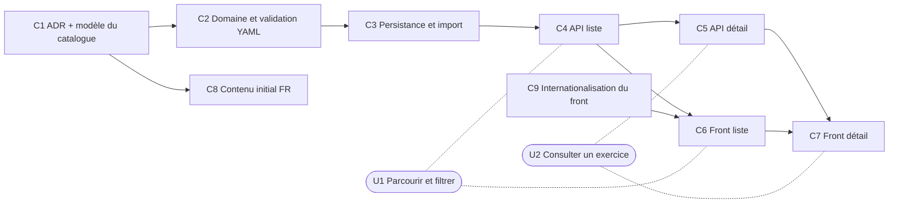

# Lot 2 : bibliothèque d'exercices

> **Statut : archive de la revue statique du 2026-11-20. Les 11 issues ont été créées sur GitHub (#78 à #88).**
> **GitHub est la source de vérité** : ce fichier n'est pas synchronisé avec les issues. Même fonctionnement que le [lot 1](lot-01-fondations.md). Les références `C1`, `U1`, etc. du texte correspondent aux numéros indiqués dans les titres ci-dessous.

Métadonnées communes : Epic `Bibliothèque d'exercices`, jalon `v0.2.0 - Bibliothèque d'exercices`, statut initial `New`.

## Grille de revue statique (à appliquer à chaque issue)

Type de revue proposé : **walkthrough** (l'auteur présente, le relecteur interroge).

| # | Critère | Question à se poser |
|---|---|---|
| 1 | Clarté | Le titre et la description sont-ils compréhensibles sans contexte ? Y a-t-il des termes ambigus ? |
| 2 | Valeur | Pourquoi cette issue existe-t-elle ? Quel besoin ou quel risque traite-t-elle ? |
| 3 | Critères d'acceptation | Sont-ils vérifiables de façon objective (Given/When/Then ou liste) ? |
| 4 | Testabilité | Peut-on écrire le test avant le code ? |
| 5 | Taille (INVEST) | Indépendante, négociable, valuable, estimable, **petite**, testable ? |
| 6 | Dépendances | Sont-elles explicites et sans cycle ? |
| 7 | Cohérence | Respecte-t-elle les ADR ? Impose-t-elle un nouvel ADR ? |
| 8 | Périmètre | Le « hors périmètre » est-il explicite ? |

## Définition de terminé (commune)

- Tests écrits **avant** le code (TDD outside-in), et verts.
- `CLAUDE.md` et la documentation concernée mis à jour.
- ADR créé ou complété si une décision est prise.
- Commits en anglais, préfixés par un gitmoji ; branche `feature/issue-<n>/<description-en-anglais>`.

## Rappel du périmètre

Un catalogue **prédéfini** d'exercices (mouvements) avec leurs **groupes musculaires** et les **équipements** nécessaires, consultable par l'utilisateur. Décisions déjà prises :
- les exercices sont des **fichiers YAML versionnés** dans le dépôt, validés par un schéma (une interface d'administration viendra plus tard) ;
- chaque exercice a un **identifiant stable** ; les noms et descriptions sont des **traductions par langue** dans des fichiers séparés ; le **français** d'abord, avec retour à une langue par défaut en l'absence de traduction ;
- la langue de l'utilisateur est un choix de profil, avec la langue du navigateur comme valeur initiale.

Hors lot : création et modification d'exercices par les utilisateurs, interface d'administration, images et vidéos, favoris, recherche textuelle avancée.

## Structure du découpage

Deux fonctionnalités (`Enhancement`) portent la valeur pour l'utilisateur. Elles sont découpées en issues techniques (`Technical Recit`) rattachées comme sous-issues. Les autres issues techniques préparent le terrain.

Dépendances externes (lot 1) : #68 (back-end), #69 (PWA), #70 (contrat OpenAPI), #71 (pile locale).

---

## C1 (#78) : Définir le modèle du catalogue et le format des fichiers

**Label** : `Technical Recit` · Priority 🏔 High · Size 🐇 Small

**Contexte.** Avant d'écrire du code ou du contenu, il faut figer ce qu'est un exercice, comment le décrire dans des fichiers YAML et comment traduire. C'est la décision sur laquelle tout le reste s'appuie.

**À faire**
- Rédiger un **ADR** qui fixe :
  - les attributs d'un exercice (identifiant stable, groupes musculaires principaux et secondaires, équipements) ;
  - les **listes de référence** des groupes musculaires et des équipements, avec leurs identifiants en anglais (par exemple `chest`, `quadriceps`, `barbell`, `dumbbell`, `machine`, `bodyweight`) ;
  - l'organisation des fichiers (`un fichier par exercice` et `un fichier de traductions par langue`) ;
  - la règle de **repli de langue** ;
  - la règle d'**évolution** : un identifiant publié ne change jamais.
- Écrire un **schéma de validation** (JSON Schema, applicable aux fichiers YAML) pour les exercices et les traductions.
- Fournir trois exercices d'exemple (un au poids du corps, un avec haltères, un avec machine).

**Critères d'acceptation**
- *Given* l'ADR publié, *When* je le lis, *Then* je peux écrire un nouvel exercice valide sans autre information.
- *Given* un fichier d'exercice valide, *When* je le valide avec le schéma, *Then* il est accepté.
- *Given* un fichier sans identifiant, avec un groupe musculaire inconnu ou une traduction sans nom, *When* je le valide, *Then* il est rejeté avec un message explicite.

**Hors périmètre.** Chargement en base, code Kotlin.

**Dépendances.** Aucune. **ADR liés.** 0005, 0006.

**Questions ouvertes (revue).** Faut-il d'autres attributs dès le départ (type de mouvement poussée ou tirage, exercice unilatéral, niveau de difficulté) ? Je propose de **ne pas** les ajouter maintenant : un champ ajouté plus tard coûte peu, un champ inutile coûte de la saisie.

---

## C2 (#79) : Domaine du catalogue et validation des données

**Label** : `Technical Recit` · Priority 🏔 High · Size 🐂 Medium

**Contexte.** Le domaine du module `catalog` doit rester pur (ADR-0005) : il ne connaît ni YAML, ni base de données. Les règles de cohérence du catalogue doivent être garanties par des tests, pas par la confiance dans les fichiers.

**À faire**
- Modéliser dans le domaine : exercice, groupe musculaire, équipement, traduction, et le catalogue comme ensemble cohérent.
- Écrire, en TDD outside-in, le **cas d'usage « charger le catalogue »** à partir d'un port de lecture de source de données (adaptateur de sortie).
- Fournir un adaptateur qui lit les **fichiers YAML** (valeurs validées par le schéma de C1) et un adaptateur **en mémoire** pour les tests.
- Vérifier au chargement : identifiants uniques, groupes musculaires et équipements référencés existants, **chaque exercice a au moins une traduction dans la langue par défaut**.

**Critères d'acceptation**
- *Given* des fichiers valides, *When* le catalogue est chargé, *Then* je récupère tous les exercices avec leurs muscles, équipements et traductions.
- *Given* deux exercices de même identifiant, *When* le catalogue est chargé, *Then* le chargement échoue en nommant l'identifiant en double.
- *Given* un exercice référençant un muscle inexistant ou sans traduction française, *When* le catalogue est chargé, *Then* le chargement échoue avec un message explicite.
- Un test ArchUnit confirme que le domaine du catalogue n'importe ni YAML ni Spring.

**Hors périmètre.** Persistance en base, API.

**Dépendances.** C1, #68. **ADR liés.** 0005, 0010.

---

## C3 (#80) : Persister le catalogue et l'importer

**Label** : `Technical Recit` · Priority 🏔 High · Size 🐂 Medium

**Contexte.** Les requêtes (filtres par muscle ou équipement, langue) se font en base. Les fichiers YAML restent la source de vérité, importés dans PostgreSQL (ADR-0006).

**À faire**
- Ajouter les dépendances de persistance (JDBC, PostgreSQL, Liquibase), qui n'existaient pas encore dans le squelette.
- Créer le schéma (tables exercices, muscles, équipements, traductions) via une migration Liquibase.
- Écrire l'**adaptateur de persistance** (Spring Data JDBC) derrière un port, avec ses entités distinctes du domaine.
- Écrire l'**import** des fichiers YAML en base, **idempotent** : relancé, il met à jour sans dupliquer. Il s'exécute au démarrage ou par une commande dédiée (à trancher dans l'issue).

**Critères d'acceptation**
- *Given* une base vide, *When* l'import s'exécute, *Then* tous les exercices du catalogue sont en base avec leurs traductions.
- *Given* une base déjà importée, *When* l'import est relancé, *Then* aucun doublon n'est créé et les modifications des fichiers sont reflétées.
- *Given* un exercice retiré des fichiers, *When* l'import s'exécute, *Then* il est **désactivé et jamais supprimé** : il reste en base avec son identifiant et ses traductions.
- *Given* un exercice désactivé qui réapparaît dans les fichiers, *When* l'import s'exécute, *Then* il est réactivé.
- Les tests d'intégration utilisent Testcontainers sur la pile choisie dans #71.

**Hors périmètre.** API, interface.

**Dépendances.** C2, #68, #71. **ADR liés.** 0006, 0010.

**Décision de revue.** Un exercice retiré des fichiers est **désactivé** et non supprimé, pour que les séances passées (historique) puissent toujours le référencer.

---

## U1 (#81) : Parcourir et filtrer la bibliothèque d'exercices

**Label** : `Enhancement` · Priority 🏔 High · Size 🦑 Large

**En tant qu'** utilisateur, **je veux** parcourir la liste des exercices et la filtrer par groupe musculaire et par équipement, **afin de** trouver rapidement un mouvement adapté à ma séance.

**Critères d'acceptation**
- *Given* le catalogue importé, *When* j'ouvre la bibliothèque, *Then* je vois la liste des exercices, avec leur nom dans ma langue.
- *Given* la liste affichée, *When* je choisis un groupe musculaire, *Then* seuls les exercices qui le sollicitent (en principal ou en secondaire) restent affichés.
- *Given* la liste affichée, *When* je choisis un ou plusieurs équipements, *Then* seuls les exercices réalisables avec cet équipement restent affichés.
- *Given* un filtre sans résultat, *Then* un message clair l'indique et je peux réinitialiser les filtres.
- *Given* un écran de téléphone, *Then* la liste et les filtres restent utilisables à une main.

**Sous-issues techniques** : C4 (API), C6 (interface).

**Dépendances.** C3.

---

## C4 (#82) : API de la liste des exercices

**Label** : `Technical Recit` (sous-issue de U1) · Priority 🏔 High · Size 🐂 Medium

**À faire**
- Compléter le **contrat OpenAPI d'abord** (#70) : `GET /api/v1/exercises`, avec filtres par groupe musculaire et par équipement, et par langue (en-tête `Accept-Language` ou paramètre `lang`, à trancher dans l'issue).
- Écrire en TDD le cas d'usage de consultation, puis l'adaptateur REST, avec le repli de langue.
- Prévoir la pagination uniquement si le contrat la justifie ; le catalogue initial est petit.

**Critères d'acceptation**
- *Given* le catalogue en base, *When* j'appelle la liste sans filtre, *Then* je reçois tous les exercices **actifs** avec noms traduits, muscles et équipements.
- *Given* un exercice désactivé, *When* j'appelle la liste, *Then* il n'y figure pas.
- *Given* aucun jeton d'authentification, *When* j'appelle la liste, *Then* la réponse est tout de même 200 (**lecture publique** pour ce jalon).
- *Given* un filtre sur un muscle, *When* j'appelle la liste, *Then* seuls les exercices concernés sont renvoyés.
- *Given* une langue sans traduction pour un exercice, *Then* le nom de la langue par défaut est renvoyé.
- *Given* un paramètre de filtre inconnu, *Then* la réponse est une erreur de validation au format du contrat.
- Les réponses respectent le contrat (test de contrat).

**Dépendances.** C3, #70.

**Décision de revue.** Le catalogue est en **lecture publique** tant que l'authentification n'existe pas. Il sera protégé dans l'epic *Gestion utilisateur*, avec un ADR qui l'indique.

---

## C5 (#83) : API du détail d'un exercice

**Label** : `Technical Recit` (sous-issue de U2) · Priority 🏕 Medium · Size 🐇 Small

**À faire**
- Compléter le contrat : `GET /api/v1/exercises/{id}`.
- Écrire en TDD le cas d'usage et l'adaptateur REST.

**Critères d'acceptation**
- *Given* un identifiant existant, *When* je l'appelle, *Then* je reçois l'exercice complet (nom, description, muscles principaux et secondaires, équipements) dans ma langue.
- *Given* un exercice **désactivé**, *When* je l'appelle par son identifiant, *Then* je le reçois avec un indicateur « inactif » (il doit rester consultable par l'historique).
- *Given* un identifiant inconnu, *Then* la réponse est 404 au format d'erreur du contrat.
- *Given* aucun jeton d'authentification, *Then* la lecture reste possible (lecture publique, voir C4).
- Les réponses respectent le contrat.

**Dépendances.** C4.

---

## U2 (#84) : Consulter le détail d'un exercice

**Label** : `Enhancement` · Priority 🏕 Medium · Size 🐂 Medium

**En tant qu'** utilisateur, **je veux** voir le détail d'un exercice (description, muscles sollicités, équipement), **afin de** savoir comment l'exécuter et s'il correspond à ma séance.

**Critères d'acceptation**
- *Given* la liste des exercices, *When* je sélectionne un exercice, *Then* je vois son détail dans ma langue.
- *Given* un exercice, *Then* les muscles principaux et secondaires sont distingués visuellement.
- *Given* un identifiant d'exercice inexistant dans l'adresse, *Then* un message clair s'affiche avec un retour à la liste.

**Sous-issues techniques** : C5 (API), C7 (interface).

**Dépendances.** C4.

---

## C6 (#85) : Interface de la liste et des filtres

**Label** : `Technical Recit` (sous-issue de U1) · Priority 🏔 High · Size 🦑 Large

**À faire**
- Écrire en TDD les composants de la liste et des filtres, avec les **ports d'accès à l'API** isolés (ADR-0003), conception **mobile d'abord**.
- Gérer les états de chargement, d'erreur et de liste vide.
- Respecter l'accessibilité de base (étiquettes, navigation au clavier, contrastes).

**Critères d'acceptation**
- *Given* une API qui répond, *When* j'ouvre la bibliothèque, *Then* la liste s'affiche.
- *Given* une API en erreur, *Then* un message d'erreur et une action de nouvelle tentative s'affichent.
- *Given* des filtres appliqués, *Then* l'adresse de la page les reflète, pour que le retour arrière conserve l'état.
- Les tests de composants utilisent un adaptateur d'API factice.

**Dépendances.** C4, C9, #69.

---

## C7 (#86) : Interface du détail d'un exercice

**Label** : `Technical Recit` (sous-issue de U2) · Priority 🏕 Medium · Size 🐇 Small

**À faire**
- Écrire en TDD le composant de détail et sa route, avec les mêmes conventions que C6.

**Critères d'acceptation**
- *Given* un identifiant valide, *When* j'ouvre la page, *Then* le détail s'affiche.
- *Given* un identifiant inconnu, *Then* un message clair et un lien de retour s'affichent.

**Dépendances.** C5, C6.

---

## C8 (#87) : Contenu initial du catalogue en français

**Label** : `Technical Recit` · Priority 🏕 Medium · Size 🐂 Medium

**Contexte.** Le catalogue n'a de valeur que s'il contient de vrais exercices. La qualité du contenu (noms exacts, muscles justes) dépend de l'auteur, pas du code.

**À faire**
- **L'assistant rédige une première version** des fichiers d'exercices et des traductions françaises d'un **premier ensemble** (proposition : une trentaine d'exercices couvrant chaque groupe musculaire et les principaux équipements).
- **Le développeur relit et valide** le contenu (cohérence des noms, muscles sollicités, équipements) : il est garant de sa justesse.
- Pour tout contenu repris d'une source externe, **vérifier et consigner la licence**.

**Critères d'acceptation**
- *Given* les fichiers, *When* la validation s'exécute, *Then* tous passent le schéma et les règles de C2.
- *Given* chaque groupe musculaire de la liste de référence, *Then* au moins deux exercices le sollicitent.
- Aucun contenu n'est repris d'une source sans licence compatible indiquée dans le dépôt.

**Hors périmètre.** Traductions dans d'autres langues, images.

**Dépendances.** C1.

**Décision de revue.** L'assistant propose une première version, à relire par le développeur. La taille du premier ensemble (une trentaine) reste une valeur de départ, ajustable en cours d'issue.

---

## C9 (#88) : Internationalisation de l'interface Angular

**Label** : `Technical Recit` · Priority 🏔 High · Size 🐂 Medium

**Contexte.** L'application doit pouvoir changer de langue selon l'option de l'utilisateur, même si seul le français existe au départ. Mieux vaut poser le mécanisme avant d'écrire les écrans, plutôt que de retraduire ensuite des textes codés en dur.

**À faire**
- Comparer les mécanismes d'internationalisation d'Angular (outil intégré, bibliothèque dédiée) et consigner le choix dans un **ADR**.
- Mettre en place la détection de la langue (langue du navigateur), le **français** comme langue par défaut et la possibilité de changer de langue à l'exécution si le mécanisme retenu le permet.
- Prévoir le **format des nombres et des dates** selon la langue.

**Critères d'acceptation**
- *Given* un navigateur en français, *When* j'ouvre l'application, *Then* l'interface est en français.
- *Given* un navigateur dans une langue non prise en charge, *Then* l'interface s'affiche en français.
- *Given* un texte traduit, *When* la langue change, *Then* le texte suit sans erreur (test automatisé avec une langue de test).
- Aucun texte visible n'est codé en dur dans les composants.

**Hors périmètre.** Stockage du choix dans le profil (epic *Gestion utilisateur*), traductions autres que le français.

**Dépendances.** #69.

---

## Décisions prises en revue

1. **Accès au catalogue** : lecture publique pour ce jalon, puis protection dans l'epic *Gestion utilisateur*, avec un ADR.
2. **Retrait d'un exercice** : désactivation, jamais de suppression (voir C3).
3. **Contenu initial** : l'assistant propose une première version, le développeur relit et valide (voir C8).
4. **Structure** : deux fonctionnalités parentes (U1, U2) avec leurs sous-issues techniques.
