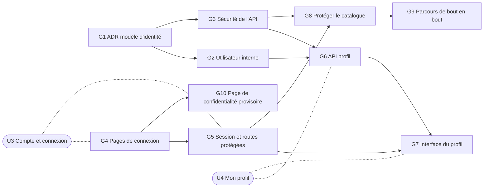

# Lot 3 : gestion utilisateur (socle d'identité)

> **Statut : archive de la revue statique du 2026-11-21. Les 12 issues ont été créées sur GitHub (#89 à #100).**
> **GitHub est la source de vérité** : ce fichier n'est pas synchronisé avec les issues. Même fonctionnement que les lots [1](lot-01-fondations.md) et [2](lot-02-bibliotheque-d-exercices.md). Les références `G1`, `U3`, etc. du texte correspondent aux numéros indiqués dans les titres ci-dessous.

Métadonnées communes : Epic `Gestion utilisateur`, statut initial `New`, jalon **`v0.3.0 - Identité utilisateur`**. Les jalons suivants ont été renumérotés : Programmes de séance `v0.4.0`, Suivi de séance `v0.5.0`, Historique `v0.6.0`, MVP `v1.0.0`.

## Grille de revue statique (à appliquer à chaque issue)

Type de revue proposé : **walkthrough** (l'auteur présente, le relecteur interroge).

| # | Critère | Question à se poser |
|---|---|---|
| 1 | Clarté | Le titre et la description sont-ils compréhensibles sans contexte ? Y a-t-il des termes ambigus ? |
| 2 | Valeur | Pourquoi cette issue existe-t-elle ? Quel besoin ou quel risque traite-t-elle ? |
| 3 | Critères d'acceptation | Sont-ils vérifiables de façon objective (Given/When/Then ou liste) ? |
| 4 | Testabilité | Peut-on écrire le test avant le code ? |
| 5 | Taille (INVEST) | Indépendante, négociable, valuable, estimable, **petite**, testable ? |
| 6 | Dépendances | Sont-elles explicites et sans cycle ? |
| 7 | Cohérence | Respecte-t-elle les ADR ? Impose-t-elle un nouvel ADR ? |
| 8 | Périmètre | Le « hors périmètre » est-il explicite ? |

## Définition de terminé (commune)

- Tests écrits **avant** le code (TDD outside-in), et verts.
- `CLAUDE.md` et la documentation concernée mis à jour.
- ADR créé ou complété si une décision est prise.
- Commits en anglais, préfixés par un gitmoji ; branche `feature/issue-<n>/<description-en-anglais>`.

## Pourquoi ce lot passe avant les programmes

Un programme de séance appartient à un utilisateur. Sans identité, il faudrait un utilisateur de substitution temporaire, puis le remplacer : du travail jeté. Ce lot pose donc : la connexion, l'utilisateur interne (ADR-0007 : jamais l'identifiant du fournisseur comme clé métier), la protection de l'API et les préférences de langue et d'unité de charge.

## Rappel du périmètre

- Authentification déléguée à **Supabase Auth** : le front obtient un jeton, le back-end le valide (ADR-0007, résultat attendu du spike #72).
- Une **table d'utilisateurs interne** relie un identifiant propre à l'application au sujet (`sub`) du jeton.
- Préférences : **langue** (par défaut : langue du navigateur) et **unité de charge** (par défaut déduite de la langue et de la région du navigateur, jamais de l'adresse IP), modifiables.
- Le catalogue, en lecture publique pour le lot 2, devient **protégé**.

**Hors lot** : export et suppression de compte (dépendent des données à exporter, lot avant `v1.0.0`), version définitive de la politique de confidentialité et des mentions RGPD (une **page provisoire** est incluse, G10), connexions sociales, double authentification, rôles administrateur, interface d'administration, configuration du service d'envoi d'e-mails en production (lot de déploiement).

## Structure du découpage

Dépendances externes : #68 (back-end), #69 (PWA), #70 (contrat OpenAPI), #71 (pile locale), #72 (spike jeton Supabase), #78 à #88 (catalogue, dont #88 internationalisation).

---

## G1 (#89) : Définir le modèle d'identité

**Label** : `Technical Recit` · Priority 🏔 High · Size 🐇 Small

**Contexte.** L'ADR-0007 pose le principe (utilisateur interne, correspondance avec le sujet du jeton) mais pas le détail. Il faut le fixer avant d'écrire du code, en tenant compte du résultat du spike #72.

**À faire**
- Rédiger un **ADR** qui fixe :
  - l'identifiant interne de l'utilisateur (généré par l'application) et la table de correspondance (émetteur et sujet du jeton, unique ensemble) ;
  - le **provisionnement** : création de l'utilisateur interne à la **première requête authentifiée**, de façon idempotente (contrainte d'unicité, sans webhook) ;
  - les données conservées dans la base applicative : **minimisation**, donc pas de copie de l'adresse e-mail dans la base applicative. L'adresse est lue dans le **jeton** (le jeton d'exemple de Supabase contient `email`, à confirmer par le spike #72) lorsqu'un envoi a lieu pendant une requête authentifiée. Le stockage ne deviendra nécessaire que pour un envoi hors requête (notification planifiée), à traiter alors par un nouvel ADR ;
  - les préférences (langue, unité de charge) et leurs valeurs par défaut ;
  - l'absence de rôles à ce stade.
- Noter les conséquences connues : le service d'envoi d'e-mails intégré de Supabase est limité (environ 2 e-mails par heure d'après sa documentation, valeur susceptible de changer) et déconseillé en production. La **vérification de l'adresse et la réinitialisation du mot de passe nécessiteront donc un service SMTP personnalisé en production**, à traiter dans le lot de déploiement. En local, un outil de capture des e-mails de la pile de développement suffit.

**Critères d'acceptation**
- *Given* l'ADR publié, *When* je le lis, *Then* je sais quelles tables et quelles règles écrire pour G2 sans autre question.
- *Given* deux requêtes simultanées d'un nouvel utilisateur, *Then* l'ADR précise qu'un seul utilisateur interne est créé, et par quel mécanisme.
- L'ADR cite le compte rendu du spike #72.

**Hors périmètre.** Code, interface.

**Dépendances.** #72. **ADR liés.** 0005, 0006, 0007.

---

## G2 (#90) : Utilisateur interne et provisionnement à la première requête

**Label** : `Technical Recit` · Priority 🏔 High · Size 🐂 Medium

**Contexte.** Le module `users` doit exposer un cas d'usage pour obtenir l'utilisateur interne correspondant à un jeton, en le créant au besoin (ADR de G1).

**À faire**
- Modéliser dans le domaine l'utilisateur, son identifiant et ses préférences (valeurs métier pour la langue et l'unité de charge).
- Écrire en TDD le cas d'usage « résoudre ou créer l'utilisateur courant » à partir de l'émetteur et du sujet du jeton, derrière un port de persistance.
- Créer le schéma (migration Liquibase) et l'adaptateur Spring Data JDBC. **Si les dépendances de persistance ne sont pas encore ajoutées (voir #80), cette issue les ajoute** : la première issue fusionnée s'en charge.

**Critères d'acceptation**
- *Given* un sujet inconnu, *When* le cas d'usage s'exécute, *Then* un utilisateur interne est créé avec les préférences par défaut.
- *Given* un sujet déjà connu, *When* le cas d'usage s'exécute, *Then* le même identifiant interne est retourné, sans doublon.
- *Given* deux exécutions simultanées pour un même nouveau sujet, *Then* un seul utilisateur existe à la fin (test d'intégration avec Testcontainers).
- Un test ArchUnit confirme que le domaine des utilisateurs reste indépendant du cadre.

**Hors périmètre.** Validation du jeton, API publique.

**Dépendances.** G1, #68, #71.

---

## G3 (#91) : Sécuriser l'API (validation du jeton et utilisateur courant)

**Label** : `Technical Recit` · Priority 🏔 High · Size 🐂 Medium

**Contexte.** Le spike #72 a prouvé la faisabilité ; il faut maintenant le code de production : valider les jetons et fournir l'utilisateur courant aux cas d'usage.

**À faire**
- Configurer le back-end comme *resource server* : validation de la signature (clés publiques de l'émetteur), de l'émetteur et de la date d'expiration, avec la configuration externalisée.
- Exposer aux cas d'usage un **port « utilisateur courant »**, sans que le domaine connaisse Spring Security.
- Renvoyer les erreurs 401 et 403 au format commun du contrat (#70).
- Laisser publics uniquement le point de santé et, jusqu'à G8, le catalogue.
- Tester avec des **jetons signés en test** (pas de dépendance à Supabase dans les tests unitaires et d'intégration).

**Critères d'acceptation**
- *Given* un jeton valide, *When* j'appelle un point protégé, *Then* la réponse est 200 et le cas d'usage reçoit l'utilisateur courant.
- *Given* un jeton absent, expiré, falsifié ou d'un autre émetteur, *Then* la réponse est 401 au format du contrat.
- *Given* le point de santé, *Then* il reste accessible sans jeton.
- Le contrat OpenAPI déclare le schéma de sécurité et les réponses 401.

**Hors périmètre.** Rôles et droits fins, protection du catalogue (G8).

**Dépendances.** G1, #70, #72. **ADR liés.** 0007.

---

## U3 (#92) : Créer un compte et me connecter

**Label** : `Enhancement` · Priority 🏔 High · Size 🦑 Large

**En tant que** visiteur, **je veux** créer un compte, me connecter, me déconnecter et récupérer mon mot de passe, **afin d'**accéder à mes données personnelles.

**Critères d'acceptation**
- *Given* l'écran d'inscription, *When* je saisis une adresse e-mail valide et un mot de passe conforme, *Then* mon compte est créé et on m'indique la suite (vérification de l'adresse si elle est exigée).
- *Given* un mot de passe non conforme, *Then* les règles à respecter sont affichées avant l'envoi.
- *Given* un compte valide, *When* je me connecte avec les bons identifiants, *Then* j'accède à l'application.
- *Given* de mauvais identifiants, *Then* un message **générique** s'affiche, sans révéler si l'adresse existe.
- *Given* une session ouverte, *When* je me déconnecte, *Then* la session prend fin et les pages protégées ne sont plus accessibles.
- *Given* l'écran « mot de passe oublié », *When* je saisis mon adresse, *Then* le même message s'affiche que le compte existe ou non.
- *Given* l'écran d'inscription, *Then* un lien vers la page d'information sur la confidentialité est visible avant l'envoi du formulaire (voir G10).
- *Given* un écran de téléphone, *Then* tous ces écrans restent utilisables à une main et accessibles au clavier.

**Sous-issues techniques** : G4, G5.

**Dépendances.** G3.

---

## G4 (#93) : Pages d'inscription, de connexion et de récupération de mot de passe

**Label** : `Technical Recit` (sous-issue de U3) · Priority 🏔 High · Size 🦑 Large

**À faire**
- Définir un **port d'authentification** côté front (inscription, connexion, déconnexion, réinitialisation) avec un **adaptateur Supabase** et un adaptateur factice pour les tests. Le choix de la bibliothèque cliente est consigné dans un ADR.
- Écrire en TDD les écrans et leur validation de formulaire, mobile d'abord, avec les textes passés par le mécanisme d'internationalisation (#88).
- Gérer les états de chargement et d'erreur.

**Critères d'acceptation**
- *Given* un adaptateur d'authentification factice, *When* je soumets l'inscription valide, *Then* l'écran de confirmation s'affiche.
- *Given* une erreur du fournisseur, *Then* un message compréhensible s'affiche et le formulaire reste utilisable.
- *Given* les champs vides ou invalides, *Then* les erreurs sont annoncées aux technologies d'assistance.
- Aucun secret n'est présent dans le code ni dans le dépôt (voir #77).

**Dépendances.** G3, #69, #71, #88.

---

## G5 (#94) : Session, rafraîchissement du jeton et routes protégées

**Label** : `Technical Recit` (sous-issue de U3) · Priority 🏔 High · Size 🐂 Medium

**À faire**
- Gérer la session côté navigateur : où le jeton est conservé (**compromis de sécurité à consigner dans un ADR**), rafraîchissement avant expiration.
- Ajouter un **intercepteur HTTP** qui joint le jeton aux appels de l'API, et une **garde de routes** qui redirige vers la connexion.
- Sur une réponse 401, tenter un rafraîchissement, puis rediriger vers la connexion en conservant la page demandée.

**Critères d'acceptation**
- *Given* un utilisateur connecté, *When* l'application appelle l'API, *Then* le jeton est envoyé dans l'en-tête d'autorisation.
- *Given* un jeton expiré, *Then* un rafraîchissement est tenté avant l'appel ou après un 401.
- *Given* un visiteur non connecté, *When* il ouvre une route protégée, *Then* il est redirigé vers la connexion puis ramené à la page demandée après connexion.
- *Given* une déconnexion, *Then* le jeton est supprimé du navigateur.

**Dépendances.** G4.

---

## U4 (#95) : Gérer mon profil (langue et unité de charge)

**Label** : `Enhancement` · Priority 🏕 Medium · Size 🐂 Medium

**En tant qu'** utilisateur, **je veux** choisir ma langue et mon unité de charge, **afin que** l'application s'affiche et enregistre mes séances comme je le souhaite.

**Critères d'acceptation**
- *Given* un premier accès, *Then* ma langue est celle de mon navigateur (français à défaut) et mon unité de charge est déduite de la langue et de la région du navigateur, sans géolocalisation par adresse IP.
- *Given* ma page de profil, *When* je change de langue, *Then* l'interface change immédiatement et le choix est conservé à ma prochaine connexion.
- *Given* ma page de profil, *When* je choisis kilogrammes ou livres, *Then* le choix est conservé pour l'enregistrement des séances.
- *Given* une valeur non prise en charge, *Then* elle est refusée avec un message clair.

**Sous-issues techniques** : G6, G7.

**Dépendances.** G3.

---

## G6 (#96) : API du profil

**Label** : `Technical Recit` (sous-issue de U4) · Priority 🏕 Medium · Size 🐇 Small

**À faire**
- Compléter le **contrat OpenAPI d'abord** : `GET /api/v1/me` et `PUT /api/v1/me/preferences` (langue, unité de charge).
- Écrire en TDD les cas d'usage et l'adaptateur REST.
- Fixer et documenter la **règle de l'unité par défaut** (par exemple livres pour la région `US`, kilogrammes sinon ; liste exacte à confirmer dans l'issue).

**Critères d'acceptation**
- *Given* un utilisateur connecté, *When* j'appelle `GET /api/v1/me`, *Then* je reçois mon identifiant interne et mes préférences.
- *Given* une mise à jour valide, *When* j'appelle `PUT /api/v1/me/preferences`, *Then* elle est enregistrée et renvoyée.
- *Given* une langue ou une unité inconnue, *Then* la réponse est une erreur de validation au format du contrat.
- *Given* aucun jeton, *Then* la réponse est 401.

**Dépendances.** G2, G3, #70.

---

## G7 (#97) : Interface du profil

**Label** : `Technical Recit` (sous-issue de U4) · Priority 🏕 Medium · Size 🐂 Medium

**À faire**
- Écrire en TDD la page de profil, avec l'accès à l'API isolé derrière un port.
- Relier le choix de langue au mécanisme d'internationalisation (#88), y compris à l'ouverture de session.

**Critères d'acceptation**
- *Given* mes préférences enregistrées, *When* j'ouvre l'application, *Then* l'interface s'affiche dans ma langue.
- *Given* un changement d'unité, *Then* il est enregistré et confirmé à l'écran.
- *Given* une API en erreur, *Then* un message et une nouvelle tentative sont proposés.

**Dépendances.** G5, G6, #88.

---

## G8 (#98) : Protéger le catalogue d'exercices

**Label** : `Technical Recit` · Priority 🏕 Medium · Size 🐇 Small

**Contexte.** Le lot 2 a laissé le catalogue en lecture publique « en attendant l'authentification » ; cette issue clôt cette décision.

**À faire**
- Exiger un jeton valide sur les points d'accès du catalogue (#82, #83) et mettre à jour le contrat.
- Adapter les tests du lot 2 (les critères de lecture publique sont remplacés).
- Compléter ou remplacer l'ADR qui avait acté la lecture publique.

**Critères d'acceptation**
- *Given* aucun jeton, *When* j'appelle la liste ou le détail des exercices, *Then* la réponse est 401.
- *Given* un jeton valide, *Then* le comportement du lot 2 est inchangé.
- *Given* un visiteur non connecté, *When* il ouvre la bibliothèque dans l'application, *Then* il est redirigé vers la connexion.

**Dépendances.** G3, G5, #82, #83.

---

## G9 (#99) : Premier parcours de bout en bout (inscription, connexion, bibliothèque)

**Label** : `Technical Recit` · Priority 🏕 Medium · Size 🐂 Medium

**Contexte.** L'ADR-0010 prévoit quelques scénarios Playwright sur la pile locale. C'est le premier : il valide l'ensemble de la chaîne (front, API, authentification locale, base).

**À faire**
- Mettre en place Playwright et son dossier (proposition : `e2e/` à la racine, **ajout à l'arborescence du dépôt**).
- Écrire le scénario : créer un compte (avec récupération du message de vérification dans l'outil de messagerie de développement de la pile locale), se connecter, ouvrir la bibliothèque, se déconnecter.
- Documenter l'exécution locale. L'exécution en intégration continue reste facultative (coût et durée), à décider dans l'issue.

**Critères d'acceptation**
- *Given* la pile locale démarrée, *When* je lance le scénario, *Then* il passe.
- *Given* un parcours cassé (par exemple une route non protégée), *Then* le scénario échoue.
- La commande et les prérequis figurent dans la documentation et dans `CLAUDE.md`.

**Hors périmètre.** Scénarios autres que le premier parcours.

**Dépendances.** G8, #71.

---

## G10 (#100) : Page d'information provisoire sur la confidentialité

**Label** : `Technical Recit` · Priority 🏕 Medium · Size 🦔 Tiny

**Contexte.** L'application collecte des données personnelles (adresse e-mail, séances). Une information claire doit être accessible dès l'inscription. Ce lot ne fournit qu'une **page provisoire** ; la version définitive est prévue avant `v1.0.0`.

**À faire**
- Créer une page statique, accessible sans connexion et depuis l'écran d'inscription, qui indique en langage clair : quelles données sont collectées, pourquoi, où elles sont hébergées (Europe), la durée de conservation prévue et comment exercer ses droits.
- Marquer clairement la page comme **provisoire** dans le dépôt (commentaire et issue de suivi pour la version définitive).
- Faire passer le texte par le mécanisme d'internationalisation (#88).

**Critères d'acceptation**
- *Given* un visiteur non connecté, *When* il ouvre l'écran d'inscription, *Then* un lien vers la page est visible.
- *Given* la page, *Then* elle est lisible sur téléphone et en français (langue par défaut).
- Le contenu a été **relu par le développeur** avant fusion ; il ne constitue pas un avis juridique.

**Hors périmètre.** Texte juridique définitif, bandeau de cookies (à évaluer selon les traceurs réellement utilisés), export et suppression de compte.

**Dépendances.** G4, #88.

---

## Décisions prises en revue

1. **Méthodes de connexion** : e-mail et mot de passe seulement, pour commencer.
2. **Vérification de l'adresse e-mail** : exigée. Le service d'envoi intégré de Supabase est limité et déconseillé en production : un SMTP personnalisé sera nécessaire, traité dans le lot de déploiement.
3. **Provisionnement** de l'utilisateur interne à la première requête authentifiée, sans webhook.
4. **Minimisation** : pas de copie de l'adresse e-mail dans la base applicative ; elle est lue dans le jeton (à confirmer par #72).
5. **Page de confidentialité provisoire** dans ce lot (G10), version définitive avant `v1.0.0`.
6. **Jalons** : créer `v0.3.0 - Identité utilisateur` et renuméroter : Programmes de séance `v0.4.0`, Suivi de séance `v0.5.0`, Historique `v0.6.0`, MVP `v1.0.0`.
7. **Dossier `e2e/`** à la racine pour les tests de bout en bout (G9).
