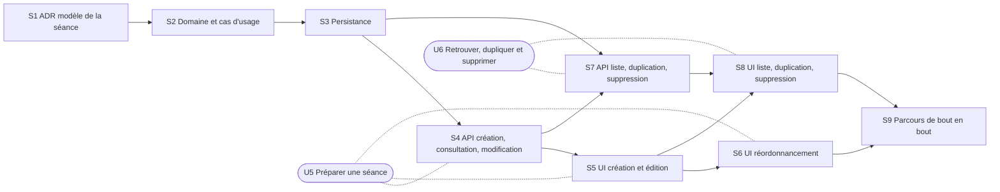

# Lot 4 : préparer une séance

> **Statut : archive de la revue statique du 2026-11-22. Les 11 issues ont été créées sur GitHub (#101 à #111).**
> **GitHub est la source de vérité** : ce fichier n'est pas synchronisé avec les issues. Même fonctionnement que les lots [1](lot-01-fondations.md), [2](lot-02-bibliotheque-d-exercices.md) et [3](lot-03-gestion-utilisateur.md). Les références `S1`, `U5`, etc. du texte correspondent aux numéros indiqués dans les titres ci-dessous.
> Ce lot **remplace** l'ancien brouillon « programmes de séance » : ce que nous appelions ainsi est une **séance** (voir le [glossaire](../glossaire.md) et l'[ADR-0011](../adr/0011-modules-et-vocabulaire-metier.md)).

Métadonnées communes : Epic `Préparation de séance`, jalon `v0.4.0 - Préparer une séance`, statut initial `New`. Module : `strength`.

## Grille de revue statique (à appliquer à chaque issue)

Type de revue proposé : **walkthrough** (l'auteur présente, le relecteur interroge).

| # | Critère | Question à se poser |
|---|---|---|
| 1 | Clarté | Le titre et la description sont-ils compréhensibles sans contexte ? Y a-t-il des termes ambigus ? |
| 2 | Valeur | Pourquoi cette issue existe-t-elle ? Quel besoin ou quel risque traite-t-elle ? |
| 3 | Critères d'acceptation | Sont-ils vérifiables de façon objective (Given/When/Then ou liste) ? |
| 4 | Testabilité | Peut-on écrire le test avant le code ? |
| 5 | Taille (INVEST) | Indépendante, négociable, valuable, estimable, **petite**, testable ? |
| 6 | Dépendances | Sont-elles explicites et sans cycle ? |
| 7 | Cohérence | Respecte-t-elle les ADR et le glossaire ? Impose-t-elle un nouvel ADR ? |
| 8 | Périmètre | Le « hors périmètre » est-il explicite ? |

## Définition de terminé (commune)

- Tests écrits **avant** le code (TDD outside-in), et verts.
- `CLAUDE.md` et la documentation concernée mis à jour.
- ADR créé ou complété si une décision est prise.
- Commits en anglais, préfixés par un gitmoji ; branche `feature/issue-<n>/<description-en-anglais>`.

## Rappel du périmètre

Une **séance de musculation** est créée au moment où l'utilisateur veut la faire. Il y choisit des **exercices de la bibliothèque** et fixe, pour chacun, une **cible** : nombre de séries, répétitions par série et **charge**. Ce lot couvre la **préparation** : créer, modifier, retrouver, dupliquer et supprimer une séance **prévue**.

Décisions déjà prises :
- cibles **dès le départ**, charge comprise, avec l'unité de charge du profil ;
- les **dernières valeurs connues** d'un exercice viendront avec l'exécution de séance (lot 5), puisqu'elles exigent des séances réalisées ;
- un exercice **désactivé** reste lisible dans une séance existante avec une mention, mais ne peut plus être ajouté ;
- la charge garde l'unité avec laquelle elle a été saisie, sans conversion automatique ;
- les termes du [glossaire](../glossaire.md) s'appliquent ; dans le code : `StrengthWorkout`, `WorkoutExercise`, `Target`, `WorkoutSet` (jamais `Session` ni `Set`).

**Hors lot** : saisie des séries réalisées et dernières valeurs connues (lot 5), historique (lot 6), programmes et planning, modèles de séance, chronomètre de repos, supersets, objectifs série par série, export (lot RGPD avant `v1.0.0`).

## Structure du découpage

Dépendances externes : #68 (back-end), #69 (PWA), #70 (contrat OpenAPI), #78 (modèle du catalogue), #80 (persistance du catalogue), #85 (liste des exercices), #88 (internationalisation), #89 (modèle d'identité), #90 (utilisateur interne), #91 (sécurité de l'API), #92 à #94 (connexion et session), #96 (API du profil, pour l'unité de charge), #99 (premier parcours de bout en bout).

---

## S1 (#101) : Définir le modèle de la séance de musculation

**Label** : `Technical Recit` · Priority 🏔 High · Size 🐇 Small

**Contexte.** Avant tout code, il faut fixer ce qu'est une séance de musculation, ses règles et la manière de la modifier. Ces choix conditionnent l'API, la base, l'interface et le futur suivi d'exécution.

**À faire**
- Rédiger un **ADR** qui fixe :
  - la structure : séance (identifiant, propriétaire, nom facultatif, état, version), exercices de séance ordonnés (identifiant propre, exercice du catalogue référencé par son identifiant stable), cible (séries, répétitions par série, charge facultative avec son unité) ;
  - les **états** : seul l'état *prévue* existe dans ce lot ; l'exécution (lot 5) ajoutera les autres, sans casser les données ;
  - les **invariants et limites** (valeurs de départ proposées : nom jusqu'à 100 caractères, 1 à 30 exercices, 1 à 20 séries, 1 à 100 répétitions, charge positive ou nulle à deux décimales) ;
  - le **mode de modification** : remplacement complet de la séance par une requête unique, avec **numéro de version** et rejet des écritures obsolètes (adapté au futur hors ligne) ;
  - la **propriété** : un utilisateur ne voit que ses séances, et la séance d'autrui répond comme une séance inexistante ;
  - les **exercices désactivés** (lisibles dans une séance existante, non ajoutables) ;
  - la **duplication** (ce qui est copié, nouvel identifiant, version initiale, état *prévue*) ;
  - la **suppression** : définitive tant que la séance est *prévue* ;
  - la **date** : pas de date prévue dans ce lot ; la date sera celle de la réalisation.

**Critères d'acceptation**
- *Given* l'ADR publié, *When* je le lis, *Then* je peux écrire le domaine de S2 sans autre question.
- *Given* les limites annoncées, *Then* chacune est justifiée et indiquée comme ajustable.
- L'ADR décrit le comportement face à un exercice désactivé, dans une séance existante comme à l'ajout.

**Hors périmètre.** Code, séries réalisées.

**Dépendances.** #78, #89. **ADR liés.** 0005, 0006, 0007, 0011.

---

## S2 (#102) : Domaine de la séance et cas d'usage

**Label** : `Technical Recit` · Priority 🏔 High · Size 🐂 Medium

**Contexte.** Le module `strength` exprime les règles de S1 dans un domaine pur (ADR-0005), testable sans base ni cadre web.

**À faire**
- Modéliser en TDD la séance, ses exercices de séance et leurs cibles, avec les valeurs métier (séries, répétitions, charge avec unité) et leurs invariants.
- Écrire les cas d'usage : créer, consulter, lister, remplacer le contenu, dupliquer, supprimer une séance prévue, tous **limités au propriétaire**.
- Définir les ports de sortie (dépôt de séances, consultation du catalogue) et fournir des **adaptateurs en mémoire**.

**Critères d'acceptation**
- *Given* une cible de 0 série ou de 101 répétitions, *When* je l'enregistre, *Then* elle est refusée avec un message explicite.
- *Given* une séance de 30 exercices, *When* j'en ajoute un trente-et-unième, *Then* l'ajout est refusé.
- *Given* un exercice désactivé, *When* je l'ajoute, *Then* l'ajout est refusé ; *Given* une séance qui le contient déjà, *Then* elle reste lisible avec une mention.
- *Given* la séance d'un autre utilisateur, *When* j'y accède, *Then* le résultat est celui d'une séance inexistante.
- *Given* une écriture avec une version obsolète, *Then* elle est rejetée.
- *Given* la duplication, *Then* la copie a un nouvel identifiant, de nouvelles lignes, la version initiale et l'état *prévue*.
- Un test ArchUnit confirme que le domaine de `strength` reste indépendant du cadre.

**Hors périmètre.** Persistance, API.

**Dépendances.** S1, #68, #90. **ADR liés.** 0005, 0010, 0011.

---

## S3 (#103) : Persistance de la séance

**Label** : `Technical Recit` · Priority 🏔 High · Size 🐂 Medium

**À faire**
- Créer le schéma (migration Liquibase) : séances et exercices de séance ordonnés, avec **contraintes vers le catalogue et vers l'utilisateur interne**.
- Écrire l'**adaptateur de persistance** (Spring Data JDBC) derrière le port, avec des entités distinctes du domaine.
- Garantir l'ordre des lignes et le contrôle de version dans la base.

**Critères d'acceptation**
- *Given* une séance enregistrée, *When* je la relis, *Then* les exercices sont dans le même ordre avec les mêmes cibles.
- *Given* deux écritures simultanées avec la même version, *Then* une seule aboutit (test d'intégration Testcontainers).
- *Given* une séance supprimée, *Then* elle n'apparaît plus et ses lignes disparaissent avec elle.
- *Given* un exercice désactivé du catalogue, *Then* les séances qui le référencent restent valides en base.

**Hors périmètre.** API, interface.

**Dépendances.** S2, #80, #90. **ADR liés.** 0006, 0010.

---

## U5 (#104) : Préparer une séance

**Label** : `Enhancement` · Priority 🏔 High · Size 🦑 Large

**En tant qu'** utilisateur connecté, **je veux** créer une séance en choisissant des exercices de la bibliothèque et en fixant mes cibles (séries, répétitions, charge), **afin d'**arriver à la salle avec un plan précis à tenir.

**Critères d'acceptation**
- *Given* mon espace, *When* je crée une séance, *Then* j'y ajoute des exercices depuis la bibliothèque, avec le même filtrage par muscle et par équipement.
- *Given* un exercice de la séance, *When* je règle ses séries, répétitions et sa charge, *Then* les valeurs sont validées avant l'enregistrement.
- *Given* la charge, *Then* elle est exprimée dans l'unité de mon profil.
- *Given* une séance, *When* je retire un exercice ou change leur ordre, *Then* le résultat est conservé après rechargement.
- *Given* un exercice désactivé dans une séance existante, *Then* une mention le signale.
- *Given* une modification faite depuis un autre appareil entre-temps, *Then* un message m'informe du conflit et je peux recharger sans perdre ma saisie.
- *Given* un écran de téléphone, *Then* tout reste utilisable à une main.

**Sous-issues techniques** : S4, S5, S6.

**Dépendances.** S3, #91.

---

## S4 (#105) : API de création, de consultation et de modification

**Label** : `Technical Recit` (sous-issue de U5) · Priority 🏔 High · Size 🐂 Medium

**À faire**
- Compléter le **contrat OpenAPI d'abord** (#70) : `POST /api/v1/strength-workouts`, `GET /api/v1/strength-workouts/{id}`, `PUT /api/v1/strength-workouts/{id}` (remplacement complet, contrôle de version), avec les noms des exercices traduits selon la langue de l'utilisateur.
- Écrire en TDD l'adaptateur REST et la traduction des erreurs (validation, conflit de version, exercice inconnu ou désactivé).

**Critères d'acceptation**
- *Given* un jeton valide, *When* je crée une séance, *Then* la réponse est 201 avec la séance et son adresse.
- *Given* un identifiant d'une autre personne, *When* je le consulte, *Then* la réponse est 404.
- *Given* une version obsolète, *When* je remplace la séance, *Then* la réponse est 409 au format du contrat.
- *Given* un exercice désactivé ou inexistant dans la liste, *Then* la réponse est une erreur de validation qui nomme l'exercice.
- *Given* le même remplacement répété, *Then* l'état final est identique (idempotence).
- *Given* aucun jeton, *Then* la réponse est 401.
- Les réponses respectent le contrat (test de contrat).

**Dépendances.** S3, #70, #91.

---

## S5 (#106) : Interface de création et d'édition de la séance

**Label** : `Technical Recit` (sous-issue de U5) · Priority 🏔 High · Size 🦑 Large

**À faire**
- Écrire en TDD l'écran de création et d'édition : nom facultatif, ajout d'exercices via un **sélecteur qui réutilise la bibliothèque** (#85), retrait, réglage des cibles.
- Valider les saisies avant envoi, gérer le conflit de version (message, rechargement sans perte de saisie) et l'unité de charge du profil (#96).
- Isoler l'accès à l'API derrière un port, mobile d'abord, avec états de chargement et d'erreur, accessibilité de base et internationalisation (#88).

**Critères d'acceptation**
- *Given* le sélecteur, *When* je filtre par muscle ou équipement, *Then* je retrouve le comportement de la bibliothèque, sans les exercices désactivés.
- *Given* une valeur hors limites, *Then* le champ signale l'erreur avant l'envoi.
- *Given* un conflit de version (409), *Then* un message s'affiche et ma saisie est conservée.
- Les tests de composants utilisent un adaptateur d'API factice.

**Dépendances.** S4, #69, #85, #88, #92, #94, #96.

---

## S6 (#107) : Interface de réordonnancement

**Label** : `Technical Recit` (sous-issue de U5) · Priority 🏕 Medium · Size 🐂 Medium

**À faire**
- Permettre de réordonner les exercices avec des **commandes accessibles** (monter et descendre, utilisables au clavier et avec un lecteur d'écran), le glisser-déposer étant un confort facultatif.
- Annoncer le changement d'ordre aux technologies d'assistance.

**Critères d'acceptation**
- *Given* une liste d'exercices, *When* j'utilise « monter » sur le deuxième, *Then* il passe en premier et l'ordre est conservé après enregistrement.
- *Given* le premier exercice, *Then* « monter » est indisponible ; de même pour « descendre » sur le dernier.
- *Given* un lecteur d'écran, *Then* le nouvel ordre est annoncé.

**Dépendances.** S5.

---

## U6 (#108) : Retrouver, dupliquer et supprimer mes séances

**Label** : `Enhancement` · Priority 🏕 Medium · Size 🐂 Medium

**En tant qu'** utilisateur, **je veux** retrouver mes séances, en dupliquer une pour en créer une variante, et supprimer celles que je ne ferai pas, **afin de** garder une liste claire.

**Critères d'acceptation**
- *Given* ma liste, *Then* je vois mes séances prévues, de la plus récente à la plus ancienne, avec leur nom éventuel et le nombre d'exercices.
- *Given* une séance, *When* je la duplique, *Then* une copie avec les mêmes exercices et les mêmes cibles apparaît dans ma liste.
- *Given* une séance prévue, *When* je la supprime après confirmation, *Then* elle disparaît définitivement de ma liste.
- *Given* aucune séance, *Then* un état vide propose d'en créer une.

**Sous-issues techniques** : S7, S8.

**Dépendances.** S4.

---

## S7 (#109) : API de la liste, de la duplication et de la suppression

**Label** : `Technical Recit` (sous-issue de U6) · Priority 🏕 Medium · Size 🐂 Medium

**À faire**
- Compléter le contrat : `GET /api/v1/strength-workouts` (les miennes, plus récentes d'abord), `POST /api/v1/strength-workouts/{id}/duplicate`, `DELETE /api/v1/strength-workouts/{id}`.
- Écrire en TDD les adaptateurs REST.

**Critères d'acceptation**
- *Given* mes séances et celles d'un autre utilisateur, *When* j'appelle la liste, *Then* je ne reçois que les miennes.
- *Given* une séance existante, *When* je la duplique, *Then* la réponse est 201 avec la copie.
- *Given* une séance prévue, *When* je la supprime, *Then* la réponse est 204 ; *Given* une séance inexistante ou d'autrui, *Then* elle est 404.
- *Given* aucun jeton, *Then* la réponse est 401.
- Les réponses respectent le contrat.

**Dépendances.** S3, S4, #70, #91.

---

## S8 (#110) : Interface de la liste, de la duplication et de la suppression

**Label** : `Technical Recit` (sous-issue de U6) · Priority 🏕 Medium · Size 🐂 Medium

**À faire**
- Écrire en TDD la liste des séances, les actions « dupliquer » et « supprimer » (confirmation avant suppression), avec états de chargement, d'erreur et de liste vide.

**Critères d'acceptation**
- *Given* la liste, *When* je duplique une séance, *Then* la copie s'affiche sans rechargement manuel.
- *Given* la suppression, *When* je confirme, *Then* la séance disparaît de la liste.
- *Given* une erreur de l'API, *Then* un message s'affiche et la liste reste inchangée.

**Dépendances.** S5, S7.

---

## S9 (#111) : Parcours de bout en bout (préparer, dupliquer, supprimer une séance)

**Label** : `Technical Recit` · Priority 🏕 Medium · Size 🐂 Medium

**À faire**
- Ajouter un scénario Playwright sur la pile locale : se connecter, créer une séance avec deux exercices de la bibliothèque, régler les cibles, réordonner, enregistrer, recharger, dupliquer, puis supprimer la copie.

**Critères d'acceptation**
- *Given* la pile locale démarrée, *When* je lance le scénario, *Then* il passe.
- *Given* un parcours cassé (par exemple l'ordre non conservé), *Then* le scénario échoue.
- La commande figure dans la documentation.

**Dépendances.** S6, S8, #99.

---

## Décisions prises en revue

Toutes les recommandations ci-dessous ont été **validées le 2026-11-22**, la duplication restant dans ce lot.

1. **Pas de date prévue** dans ce lot : la date sera celle de la réalisation (lot 5), ce qui évite d'introduire le planning. À confirmer.
2. **Charge facultative** : la charge fait partie de la cible, mais un exercice au poids du corps n'a pas de charge. Je recommande de **l'autoriser vide**.
3. **Nom de la séance** : facultatif ; pour une copie, je recommande de **conserver le même nom** sans suffixe automatique (la liste montre l'ordre de création).
4. **Suppression** : définitive pour une séance **prévue** (aucun historique n'en dépend). Une séance réalisée aura un traitement différent au lot 5.
5. **Limites proposées** (valeurs de ma part, ajustables) : 100 caractères, 30 exercices, 20 séries, 100 répétitions, deux décimales pour la charge. Faut-il plafonner le nombre de séances par utilisateur ? Je recommande **non** (voir [la note sur le modèle économique](../analyses/2026-11-modele-economique.md)).
6. **Numéro de version dès le contrat** (rejet 409) : je le recommande, car le hors ligne prévu au second incrément le rendra nécessaire.
7. **Nom du point d'accès** : `/api/v1/strength-workouts`, aligné sur le glossaire (`workouts` reste réservé au futur tronc commun).
8. **Même exercice plusieurs fois** dans une séance : autorisé (échauffement puis séries de travail).
9. **Duplication** : elle prend tout son sens quand on duplique une séance **réalisée** (lot 5), qui préremplira alors les dernières valeurs. Je la conserve dans ce lot, où elle sert surtout à créer des variantes (séance A, séance B), parce que vous l'avez placée dans le MVP. Faut-il la déplacer au lot 5 ?
