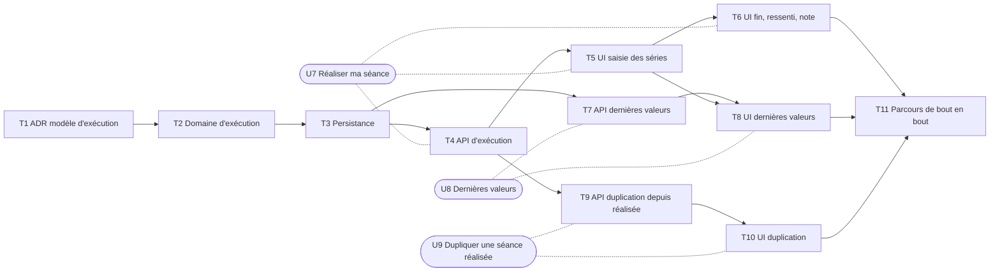

# Lot 5 : suivre une séance

> **Statut : archive de la revue statique du 2026-11-23. Les 14 issues ont été créées sur GitHub (#112 à #125).**
> **GitHub est la source de vérité** : ce fichier n'est pas synchronisé avec les issues. Même fonctionnement que les lots [1](lot-01-fondations.md) à [4](lot-04-preparer-une-seance.md). Les références `T1`, `U7`, etc. du texte correspondent aux numéros indiqués dans les titres ci-dessous.

Métadonnées communes : Epic `Suivi de séance`, jalon `v0.5.0 - Suivi de séance`, statut initial `New`. Module : `strength`.

## Grille de revue statique (à appliquer à chaque issue)

Type de revue proposé : **walkthrough** (l'auteur présente, le relecteur interroge).

| # | Critère | Question à se poser |
|---|---|---|
| 1 | Clarté | Le titre et la description sont-ils compréhensibles sans contexte ? Y a-t-il des termes ambigus ? |
| 2 | Valeur | Pourquoi cette issue existe-t-elle ? Quel besoin ou quel risque traite-t-elle ? |
| 3 | Critères d'acceptation | Sont-ils vérifiables de façon objective (Given/When/Then ou liste) ? |
| 4 | Testabilité | Peut-on écrire le test avant le code ? |
| 5 | Taille (INVEST) | Indépendante, négociable, valuable, estimable, **petite**, testable ? |
| 6 | Dépendances | Sont-elles explicites et sans cycle ? |
| 7 | Cohérence | Respecte-t-elle les ADR et le glossaire ? Impose-t-elle un nouvel ADR ? |
| 8 | Périmètre | Le « hors périmètre » est-il explicite ? |

## Définition de terminé (commune)

- Tests écrits **avant** le code (TDD outside-in), et verts.
- `CLAUDE.md` et la documentation concernée mis à jour.
- ADR créé ou complété si une décision est prise.
- Commits en anglais, préfixés par un gitmoji ; branche `feature/issue-<n>/<description-en-anglais>`.

## Rappel du périmètre

Une séance **prévue** (lot 4) peut maintenant être **réalisée** : l'utilisateur la démarre, saisit pour chaque série les **répétitions réussies** et la **charge**, puis la termine. L'application affiche les **dernières valeurs connues** de chaque exercice, pour viser « autant ou plus que la fois précédente ». Une séance réalisée peut être **dupliquée** pour les prochaines fois.

Décisions déjà prises :
- **enregistrement série par série** : chaque série est enregistrée dès qu'on la valide, avec un identifiant généré par l'application ; l'opération est idempotente (base du futur hors ligne) ;
- **écarts libres au plan** : on peut ajouter ou retirer des séries, ajouter un exercice du catalogue, ou passer un exercice ; le réalisé compte, la cible reste un repère ;
- **duplication d'une séance réalisée au choix** : reprendre les cibles d'origine, ou reprendre le réalisé comme nouvelles cibles ;
- **ressenti sur 5 et note facultative** à la fin de la séance ; le RPE détaillé reste hors MVP ;
- **dernières valeurs connues** : résultats de la dernière réalisation de l'exercice, dans n'importe quelle séance (glossaire) ;
- l'unité de charge est conservée telle que saisie ;
- les supersets et le minuteur sont **hors lot** (après le MVP, concept de bloc seulement réservé) ; l'historique est le lot 6.

**Hors lot** : supersets (blocs d'exercices) et minuteur de travail et de repos, RPE, correction d'une séance terminée (lot 6), suppression d'une séance terminée (hors compte), programmes, séances d'endurance, hors ligne complet (second incrément).

## Structure du découpage

Dépendances externes : #68 (back-end), #69 (PWA), #70 (contrat OpenAPI), #85 (liste des exercices), #88 (internationalisation), #91 (sécurité de l'API), #92 à #94 (connexion et session), #96 (API du profil), #101 à #103 (modèle, domaine et persistance de la séance), #105 (API de la séance), #106 (interface d'édition de séance), #109 et #110 (liste et duplication), #111 (parcours de bout en bout du lot 4).

---

## T1 (#112) : Définir le modèle d'exécution d'une séance

**Label** : `Technical Recit` · Priority 🏔 High · Size 🐇 Small

**Contexte.** Le lot 4 a posé la séance *prévue*. L'exécution ajoute des états, des séries réalisées et des règles qu'il faut fixer avant tout code, car elles conditionnent l'API, la base et l'interface, ainsi que le futur hors ligne.

**À faire**
- Rédiger un **ADR** qui fixe :
  - les **états** : *prévue* → *en cours* → *terminée* ; l'état *annulée* reste réservé aux programmes (glossaire) ;
  - la **série réalisée** : identifiant **généré par l'application**, exercice de séance concerné, rang, répétitions réussies, charge avec son unité, horodatage ; opérations **idempotentes** (rejouer une même requête ne duplique rien) ;
  - les **horodatages** de début et de fin, en heure universelle, avec affichage dans l'heure locale ;
  - les **limites** (valeurs de départ proposées : 0 à 100 répétitions réussies, où 0 signifie une série ratée ; charge positive ou nulle à deux décimales ; jusqu'à 30 séries par exercice) ;
  - les **écarts au plan** : ajouter ou retirer des séries, ajouter un exercice du catalogue (cible facultative), passer un exercice ; les cibles de la séance préparée ne changent pas en cours de séance ;
  - **une seule séance en cours par utilisateur** ;
  - la **fin** : ressenti de 1 à 5 facultatif, note libre facultative (jusqu'à 500 caractères) ;
  - l'**abandon** d'une séance en cours (voir les décisions de revue) ;
  - les **dernières valeurs connues** : dernière séance *terminée* contenant l'exercice, séries telles que saisies avec leurs unités, séance en cours exclue ;
  - la **duplication** d'une séance réalisée : choix entre cibles d'origine et réalisé ;
  - la **réserve pour les supersets** (après le MVP) : un exercice de séance pourra appartenir à un **bloc** facultatif (regroupement d'exercices enchaînés, avec un nombre de tours et, plus tard, des durées de travail et de repos). L'ADR le prévoit comme extension **sans rupture** (champ facultatif, aucune règle d'ordre imposée aujourd'hui) mais **n'implémente rien** ; voir le [glossaire](../glossaire.md) et la [note d'analyse](../analyses/2026-11-supersets-et-minuteur.md).

**Critères d'acceptation**
- *Given* l'ADR publié, *When* je le lis, *Then* je peux écrire le domaine de T2 sans autre question.
- *Given* une série rejouée avec le même identifiant, *Then* l'ADR précise que le résultat est identique et par quel mécanisme.
- *Given* un exercice désactivé, *Then* l'ADR précise le comportement dans une séance en cours.
- *Given* une séance en cours sans aucune série réalisée, *Then* l'ADR précise que sa fin est refusée et que l'utilisateur doit l'abandonner (sans série, il n'y a pas de séance).

**Hors périmètre.** Code, chronomètre, RPE.

**Dépendances.** #101. **ADR liés.** 0005, 0011.

---

## T2 (#113) : Domaine d'exécution

**Label** : `Technical Recit` · Priority 🏔 High · Size 🐂 Medium

**Contexte.** Le module `strength` exprime les règles de T1 dans un domaine pur (ADR-0005), testable sans base ni cadre web.

**À faire**
- Modéliser en TDD l'état *en cours* et *terminée*, la série réalisée et ses invariants.
- Écrire les cas d'usage : démarrer, enregistrer une série (idempotent), corriger ou retirer une série pendant la séance, ajouter un exercice, retirer un exercice sans série, terminer (avec ressenti et note), abandonner, calculer les dernières valeurs connues.
- Étendre les adaptateurs en mémoire existants.

**Critères d'acceptation**
- *Given* une séance prévue, *When* je la démarre, *Then* elle passe à *en cours* avec un horodatage de début.
- *Given* une séance déjà en cours, *When* j'en démarre une seconde, *Then* le démarrage est refusé avec un message explicite.
- *Given* une série enregistrée, *When* je rejoue la même série (même identifiant), *Then* elle n'est pas dupliquée.
- *Given* 101 répétitions ou une charge négative, *Then* la série est refusée.
- *Given* une séance terminée, *When* j'y ajoute une série, *Then* l'ajout est refusé.
- *Given* un exercice jamais réalisé, *Then* ses dernières valeurs connues sont vides.
- Un test ArchUnit confirme que le domaine reste indépendant du cadre.
- *Given* une séance en cours sans aucune série, *When* je la termine, *Then* la fin est refusée avec un message explicite ; *When* je l'abandonne, *Then* l'abandon est accepté.

**Hors périmètre.** Persistance, API.

**Dépendances.** T1, #102. **ADR liés.** 0005, 0010, 0011.

---

## T3 (#114) : Persistance de l'exécution

**Label** : `Technical Recit` · Priority 🏔 High · Size 🐂 Medium

**À faire**
- Compléter le schéma (migration Liquibase) : états, horodatages, séries réalisées, ressenti et note, avec contraintes d'intégrité et **unicité de l'identifiant de série**.
- Garantir en base **une seule séance en cours par utilisateur**.
- Prévoir l'index qui rend la recherche des dernières valeurs rapide.
- Étendre l'adaptateur de persistance (Spring Data JDBC).

**Critères d'acceptation**
- *Given* une série enregistrée deux fois avec le même identifiant, *Then* une seule ligne existe (test d'intégration Testcontainers).
- *Given* deux démarrages simultanés pour un même utilisateur, *Then* un seul aboutit.
- *Given* des séances terminées, *When* je cherche les dernières valeurs d'un exercice, *Then* j'obtiens celles de la plus récente, séance en cours exclue.

**Hors périmètre.** API, interface.

**Dépendances.** T2, #103. **ADR liés.** 0006, 0010.

---

## U7 (#115) : Réaliser ma séance

**Label** : `Enhancement` · Priority 🏔 High · Size 🦑 Large

**En tant qu'** utilisateur, **je veux** démarrer ma séance, saisir pour chaque série mes répétitions réussies et ma charge, puis la terminer avec mon ressenti, **afin de** garder une trace fiable de ce que j'ai réellement fait.

**Critères d'acceptation**
- *Given* une séance prévue, *When* je la démarre, *Then* je vois ses exercices dans l'ordre, avec leurs cibles.
- *Given* un exercice, *When* je valide une série, *Then* les champs sont préremplis avec la cible (je n'ajuste que l'écart) et la série est enregistrée immédiatement.
- *Given* une série enregistrée, *When* je ferme l'application ou perds le réseau puis reviens, *Then* mes séries déjà validées sont toujours là.
- *Given* la séance en cours, *When* j'ajoute ou retire une série, ajoute un exercice de la bibliothèque ou en passe un, *Then* le réalisé est conservé tel quel.
- *Given* une séance en cours, *When* je la termine, *Then* je peux indiquer un ressenti de 1 à 5 et une note facultative.
- *Given* une séance déjà en cours, *When* j'essaie d'en démarrer une autre, *Then* un message m'invite à terminer ou abandonner la première.
- *Given* un écran de téléphone, *Then* la saisie reste utilisable à une main, avec de grandes zones de saisie.

**Sous-issues techniques** : T4, T5, T6.

**Dépendances.** T3, #105.

---

## T4 (#116) : API d'exécution

**Label** : `Technical Recit` (sous-issue de U7) · Priority 🏔 High · Size 🐂 Medium

**À faire**
- Compléter le **contrat OpenAPI d'abord** (#70) : démarrer, enregistrer, corriger et retirer une série (identifiants fournis par le client), ajouter ou retirer un exercice de la séance en cours, terminer (ressenti et note), abandonner.
- Écrire en TDD les adaptateurs REST et la traduction des erreurs (état invalide, séance déjà en cours, limites dépassées).

**Critères d'acceptation**
- *Given* une séance prévue, *When* je la démarre, *Then* la réponse est 200 avec l'état *en cours*.
- *Given* une série envoyée deux fois avec le même identifiant, *Then* la seconde réponse est identique à la première, sans doublon.
- *Given* une séance terminée, *When* j'y envoie une série, *Then* la réponse est une erreur de validation au format du contrat.
- *Given* la séance d'un autre utilisateur, *Then* la réponse est 404 ; *Given* aucun jeton, *Then* 401.
- Les réponses respectent le contrat (test de contrat).

**Dépendances.** T3, #105, #70, #91.

---

## T5 (#117) : Interface de saisie des séries

**Label** : `Technical Recit` (sous-issue de U7) · Priority 🏔 High · Size 🦑 Large

**À faire**
- Écrire en TDD l'écran de séance en cours : démarrage, liste des exercices, saisie des séries **préremplies avec la cible**, ajout et retrait de séries, ajout d'un exercice via le **sélecteur de la bibliothèque** (#85), exercice passé.
- Enregistrer **chaque série dès sa validation**, avec un identifiant généré par l'application, et gérer l'échec réseau (la série reste visible comme « en attente » et est renvoyée).
- Isoler l'accès à l'API derrière un port, mobile d'abord, grandes zones de saisie, accessibilité de base et internationalisation (#88). L'unité de charge est celle du profil (#96).

**Critères d'acceptation**
- *Given* une API qui répond, *When* je valide une série, *Then* elle est enregistrée et marquée comme telle.
- *Given* une API injoignable, *When* je valide une série, *Then* elle reste affichée comme « en attente » et est renvoyée au retour du réseau, sans doublon.
- *Given* une valeur hors limites, *Then* le champ signale l'erreur avant l'envoi.
- *Given* une séance en cours déjà démarrée, *When* je rouvre l'application, *Then* je reprends là où je me suis arrêté.
- Les tests de composants utilisent un adaptateur d'API factice.

**Dépendances.** T4, #106, #69, #85, #88, #92, #94, #96.

---

## T6 (#118) : Interface de fin de séance (ressenti et note)

**Label** : `Technical Recit` (sous-issue de U7) · Priority 🏕 Medium · Size 🐇 Small

**À faire**
- Écrire en TDD l'écran de fin : ressenti de 1 à 5 (facultatif), note libre (facultative), récapitulatif simple (nombre d'exercices et de séries réalisées, durée).
- Gérer l'**abandon** avec confirmation.

**Critères d'acceptation**
- *Given* une séance en cours, *When* je la termine sans renseigner ressenti ni note, *Then* elle est terminée normalement.
- *Given* un ressenti et une note, *When* je termine, *Then* ils sont enregistrés avec la séance.
- *Given* une note de plus de 500 caractères, *Then* un message l'indique avant l'envoi.
- *Given* l'abandon, *When* je confirme, *Then* la séance en cours est traitée selon la règle de T1.
- *Given* une séance en cours sans aucune série, *When* je tente de la terminer, *Then* un message m'indique que je dois enregistrer une série ou abandonner la séance.

**Dépendances.** T5.

---

## U8 (#119) : Retrouver mes dernières valeurs connues

**Label** : `Enhancement` · Priority 🏔 High · Size 🐂 Medium

**En tant qu'** utilisateur, **je veux** voir ce que j'ai fait la dernière fois pour chaque exercice, **afin de** viser autant ou plus.

**Critères d'acceptation**
- *Given* un exercice que j'ai déjà réalisé, *When* je prépare ou réalise une séance, *Then* je vois mes dernières séries (répétitions et charge, avec l'unité d'origine) et la date.
- *Given* un exercice jamais réalisé, *Then* aucune valeur n'est affichée et rien ne signale une erreur.
- *Given* la séance en cours, *Then* ses propres séries ne comptent pas comme « dernière fois ».
- *Given* un écart entre la dernière fois et ma saisie, *Then* il est affiché de façon neutre (par exemple « +2,5 kg »).

**Sous-issues techniques** : T7, T8.

**Dépendances.** T3.

---

## T7 (#120) : API des dernières valeurs connues

**Label** : `Technical Recit` (sous-issue de U8) · Priority 🏔 High · Size 🐂 Medium

**À faire**
- Compléter le contrat : une requête qui renvoie, pour une **liste d'exercices**, leur dernière réalisation (séries et date), pour éviter une requête par exercice.
- Écrire en TDD le cas d'usage de lecture et l'adaptateur REST.

**Critères d'acceptation**
- *Given* plusieurs séances terminées, *When* je demande les dernières valeurs de trois exercices, *Then* je reçois pour chacun celles de la séance terminée la plus récente qui le contient.
- *Given* un exercice jamais réalisé, *Then* il est présent dans la réponse avec une valeur vide.
- *Given* les séances d'un autre utilisateur, *Then* elles n'apparaissent jamais.
- *Given* aucun jeton, *Then* la réponse est 401.
- Les réponses respectent le contrat.

**Dépendances.** T3, #70, #91.

---

## T8 (#121) : Affichage des dernières valeurs connues

**Label** : `Technical Recit` (sous-issue de U8) · Priority 🏔 High · Size 🐇 Small

**À faire**
- Afficher les dernières valeurs dans l'**éditeur de séance** (#106) et dans l'**écran de séance en cours** (T5), de façon sobre sur mobile : cible, dernière fois, saisie du jour.
- Afficher l'écart de façon neutre.

**Critères d'acceptation**
- *Given* l'éditeur de séance, *Then* chaque exercice déjà réalisé affiche sa dernière réalisation.
- *Given* l'écran de séance en cours, *When* je saisis une série, *Then* l'écart avec la dernière fois s'affiche.
- *Given* un exercice jamais réalisé, *Then* l'interface reste propre, sans message d'erreur.
- *Given* une API en erreur, *Then* l'interface continue de fonctionner sans les dernières valeurs.

**Dépendances.** T5, T7, #106.

---

## U9 (#122) : Dupliquer une séance réalisée

**Label** : `Enhancement` · Priority 🏕 Medium · Size 🐂 Medium

**En tant qu'** utilisateur, **je veux** dupliquer une séance déjà réalisée, en choisissant de reprendre ses cibles ou ce que j'ai accompli, **afin de** préparer la prochaine séance en quelques secondes.

**Critères d'acceptation**
- *Given* une séance terminée, *When* je la duplique, *Then* je choisis entre « reprendre les cibles d'origine » et « reprendre ce que j'ai réalisé comme cibles ».
- *Given* mon choix, *Then* la copie est une séance *prévue* avec les mêmes exercices dans le même ordre et les cibles correspondantes.
- *Given* la copie, *Then* aucune série réalisée ni aucun ressenti n'est copié.
- *Given* un exercice désactivé dans la séance d'origine, *Then* il est signalé et laissé de côté selon la règle de l'ADR.

**Sous-issues techniques** : T9, T10.

**Dépendances.** T4, #108.

---

## T9 (#123) : API de duplication d'une séance réalisée

**Label** : `Technical Recit` (sous-issue de U9) · Priority 🏕 Medium · Size 🐇 Small

**À faire**
- Étendre le contrat de duplication (#109) pour accepter une séance terminée et l'option « cibles d'origine » ou « réalisé ».
- Écrire en TDD le cas d'usage et l'adaptateur REST.

**Critères d'acceptation**
- *Given* une séance terminée et l'option « cibles d'origine », *When* je la duplique, *Then* la copie reprend ses cibles.
- *Given* l'option « réalisé », *Then* la copie prend, pour chaque exercice, le nombre de séries réalisées, leurs répétitions et leur charge comme nouvelles cibles.
- *Given* un exercice sans série réalisée, *Then* sa cible d'origine est conservée.
- *Given* la séance d'un autre utilisateur, *Then* la réponse est 404.

**Dépendances.** T3, #109.

---

## T10 (#124) : Interface de duplication d'une séance réalisée

**Label** : `Technical Recit` (sous-issue de U9) · Priority 🏕 Medium · Size 🐇 Small

**À faire**
- Ajouter l'action « dupliquer » sur une séance terminée, avec le choix entre cibles d'origine et réalisé.

**Critères d'acceptation**
- *Given* une séance terminée, *When* je choisis « dupliquer », *Then* les deux options sont proposées clairement.
- *Given* mon choix, *Then* la copie apparaît dans ma liste des séances prévues.
- *Given* une erreur de l'API, *Then* un message s'affiche et rien n'est créé.

**Dépendances.** T9, #110.

---

## T11 (#125) : Parcours de bout en bout (préparer, réaliser, retrouver, dupliquer)

**Label** : `Technical Recit` · Priority 🏕 Medium · Size 🐂 Medium

**À faire**
- Ajouter un scénario Playwright sur la pile locale : préparer une séance, la démarrer, saisir trois séries dont une avec écart, terminer avec un ressenti, vérifier les dernières valeurs dans une nouvelle séance, puis dupliquer en choisissant « réalisé ».

**Critères d'acceptation**
- *Given* la pile locale démarrée, *When* je lance le scénario, *Then* il passe.
- *Given* un parcours cassé (par exemple une série non enregistrée), *Then* le scénario échoue.
- La commande figure dans la documentation.

**Dépendances.** T6, T8, T10, #111.

---

## Décisions prises en revue

Validées le 2026-11-22 :
1. **Enregistrement série par série**, avec identifiant généré par l'application et opérations idempotentes.
2. **Écarts libres au plan** pendant la séance.
3. **Duplication d'une séance réalisée au choix** : cibles d'origine ou réalisé.
4. **Ressenti sur 5 et note facultative** dans ce lot.

## Autres décisions (validées le 2026-11-23)

5. **Une seule séance en cours par utilisateur** : recommandé, pour éviter les saisies parallèles confuses.
6. **Abandon** : je recommande que l'abandon d'une séance en cours la **remette en état prévue** et **efface ses séries**, après une confirmation claire ; l'utilisateur qui veut garder ce qu'il a fait **termine** la séance. Autre option : conserver les séries d'une séance abandonnée.
7. **Correction après coup** : possible **pendant** la séance ; la correction d'une séance **terminée** est renvoyée au lot 6 (historique).
8. **Cible d'un exercice ajouté pendant la séance** : facultative.
9. **Dernières valeurs connues** : dernière séance **terminée** contenant l'exercice ; séance en cours et séances abandonnées exclues.
10. **Limites proposées** (valeurs de ma part, ajustables) : 0 à 100 répétitions réussies, jusqu'à 30 séries par exercice, note de 500 caractères.
11. **Un exercice passé** : conservé dans la séance, sans série, plutôt que supprimé.
12. **Chronomètre de repos** : hors lot, comme convenu.
13. **Supersets et minuteur** : lot dédié **après le MVP**. Le **concept de bloc est réservé** dans T1 et dans l'issue #101 (aucune implémentation). Le minuteur sera réalisé dans la **PWA au mieux** (heure de fin enregistrée, bips écran allumé), les bips écran verrouillé revenant au **client Flutter**.
