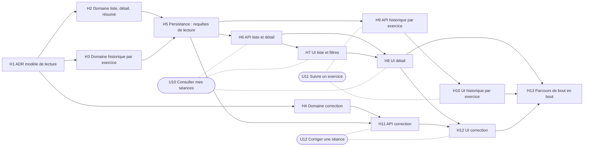

# Lot 6 : historique

> **Statut : archive de la revue statique du 2026-11-24. Les 16 issues ont été créées sur GitHub (#126 à #141).**
> Même fonctionnement que les lots [1](lot-01-fondations.md) à [5](lot-05-suivre-une-seance.md). Une fois les issues créées, GitHub devient la source de vérité.

Métadonnées communes : Epic `Historique`, jalon `v0.6.0 - Historique`, statut initial `New`. Module : `strength`.

## Grille de revue statique (à appliquer à chaque issue)

Type de revue proposé : **walkthrough** (l'auteur présente, le relecteur interroge).

| # | Critère | Question à se poser |
|---|---|---|
| 1 | Clarté | Le titre et la description sont-ils compréhensibles sans contexte ? Y a-t-il des termes ambigus ? |
| 2 | Valeur | Pourquoi cette issue existe-t-elle ? Quel besoin ou quel risque traite-t-elle ? |
| 3 | Critères d'acceptation | Sont-ils vérifiables de façon objective (Given/When/Then ou liste) ? |
| 4 | Testabilité | Peut-on écrire le test avant le code ? |
| 5 | Taille (INVEST) | Indépendante, négociable, valuable, estimable, **petite**, testable ? |
| 6 | Dépendances | Sont-elles explicites et sans cycle ? |
| 7 | Cohérence | Respecte-t-elle les ADR et le glossaire ? Impose-t-elle un nouvel ADR ? |
| 8 | Périmètre | Le « hors périmètre » est-il explicite ? |

## Définition de terminé (commune)

- Tests écrits **avant** le code (TDD outside-in), et verts.
- `CLAUDE.md` et la documentation concernée mis à jour.
- ADR créé ou complété si une décision est prise.
- Commits en anglais, préfixés par un gitmoji ; branche `feature/issue-<n>/<description-en-anglais>`.

## Rappel du périmètre

L'utilisateur consulte ses séances **terminées**, sur mobile comme sur ordinateur ou tablette : la liste, le détail d'une séance, un **résumé chiffré** (séries, volume), et l'**historique d'un exercice** (toutes ses réalisations dans le temps, avec les meilleures valeurs). Il peut **corriger** une séance terminée. Les graphiques de progression sont **après le MVP**.

Décisions déjà prises :
- l'historique couvre la **liste**, le **détail**, le **résumé chiffré par séance** et l'**historique par exercice** ;
- une séance terminée peut être **corrigée** mais **pas supprimée** individuellement (la suppression se fait avec le compte) ;
- la liste se filtre par **période et par exercice** ; la période est un **paramètre des cas d'usage**, ce qui prépare la future fenêtre d'analyse (voir [la note sur le modèle économique](../analyses/2026-11-modele-economique.md)) ;
- aucune limitation du nombre de séances au MVP ;
- les termes du [glossaire](../glossaire.md) s'appliquent.

**Hors lot** : graphiques de progression et tendances, estimation de la charge maximale (1RM), comparaison entre périodes, export (lot RGPD avant `v1.0.0`), séances d'endurance, programmes, suppression d'une séance terminée.

## Structure du découpage

Dépendances externes : #68 (back-end), #69 (PWA), #70 (contrat OpenAPI), #85 (liste des exercices), #88 (internationalisation), #91 (sécurité de l'API), #92 à #94 (connexion et session), #96 (API du profil, pour l'unité de charge), #101 et #103 (modèle et persistance de la séance), #112 à #114 (exécution), #116 à #118 (API et interface d'exécution), #125 (parcours de bout en bout du lot 5).

---

## H1 (#126) : Définir le modèle de lecture de l'historique

**Label** : `Technical Recit` · Priority 🏔 High · Size 🐇 Small

**Contexte.** L'historique repose sur des calculs (volume, meilleures valeurs) et des conversions d'unités qu'il faut définir précisément avant d'écrire du code, sinon chaque couche les interprétera à sa façon.

**À faire**
- Rédiger un **ADR** qui fixe :
  - les **séances de l'historique** : seules les séances *terminées* y figurent ; les séances prévues, en cours ou abandonnées n'y sont pas ;
  - le **mode de calcul** : les résumés et les meilleures valeurs sont calculés **à la lecture**, sans table d'agrégats stockée, ce qui garantit leur cohérence après une correction (à réexaminer quand le volume de données le justifiera) ;
  - la **conversion d'unités** : 1 livre vaut exactement 0,45359237 kilogramme ; les valeurs d'une série sont **affichées telles que saisies** ; les **totaux et comparaisons** sont calculés avec précision décimale puis exprimés dans l'**unité du profil** ;
  - le **volume** d'une séance : somme, sur ses séries, des répétitions réussies multipliées par la charge ; les séries sans charge (poids du corps) n'y contribuent pas ;
  - les **meilleures valeurs d'un exercice** (valeurs de départ) : charge maximale (avec les répétitions réalisées à cette charge), nombre maximal de répétitions sur une série, volume maximal sur une séance ; les séries à zéro répétition sont exclues ; aucune estimation de charge maximale théorique ;
  - la **pagination** par curseur (date de fin et identifiant), 20 éléments par page ;
  - la **période** : l'API exprime les bornes en **instants universels** ; le client convertit les jours locaux de l'utilisateur ; la période est un **paramètre** des cas d'usage ;
  - la **correction** d'une séance terminée : séries modifiables, ajoutables et retirables, ressenti et note modifiables ; exercices non modifiables ; pas de suppression individuelle.

**Critères d'acceptation**
- *Given* l'ADR publié, *When* je le lis, *Then* je peux écrire les domaines de H2, H3 et H4 sans autre question.
- *Given* une série en livres et une en kilogrammes, *Then* l'ADR précise le résultat du total et son unité d'affichage.
- *Given* une séance corrigée, *Then* l'ADR précise que les dernières valeurs connues et les meilleures valeurs reflètent la correction.

**Hors périmètre.** Code, graphiques.

**Dépendances.** #101, #112. **ADR liés.** 0005, 0006, 0011.

---

## H2 (#127) : Domaine de la liste, du détail et du résumé

**Label** : `Technical Recit` · Priority 🏔 High · Size 🐂 Medium

**Contexte.** Le module `strength` expose en lecture les séances terminées de l'utilisateur, avec le résumé chiffré défini par H1.

**À faire**
- Écrire en TDD les cas d'usage : lister les séances terminées (période, exercice, curseur de pagination), consulter le détail d'une séance, calculer le résumé (nombre d'exercices, de séries, durée, volume).
- Implémenter la conversion d'unités et le calcul du volume dans le domaine, avec précision décimale.
- Étendre les adaptateurs en mémoire existants.

**Critères d'acceptation**
- *Given* des séances terminées et d'autres non terminées, *When* je liste l'historique, *Then* seules les terminées apparaissent, de la plus récente à la plus ancienne.
- *Given* un filtre de période, *Then* seules les séances terminées dans la période sont renvoyées.
- *Given* un filtre sur un exercice, *Then* seules les séances qui le contiennent sont renvoyées.
- *Given* 5 séries à 10 répétitions à 20 kg (en kilogrammes), *Then* le volume est de 1 000 kg ; *Given* les mêmes séries en livres, *Then* le volume est converti avec précision et exprimé dans l'unité du profil.
- *Given* la séance d'un autre utilisateur, *Then* elle est inaccessible (comme une séance inexistante).
- Un test ArchUnit confirme que le domaine reste indépendant du cadre.

**Hors périmètre.** Requêtes SQL, API.

**Dépendances.** H1, #113. **ADR liés.** 0005, 0010, 0011.

---

## H3 (#128) : Domaine de l'historique par exercice

**Label** : `Technical Recit` · Priority 🏔 High · Size 🐂 Medium

**À faire**
- Écrire en TDD le cas d'usage qui, pour un exercice, renvoie toutes ses réalisations terminées dans la période (séries, date) et les **meilleures valeurs** définies par H1 (charge maximale avec ses répétitions, répétitions maximales, volume maximal sur une séance).

**Critères d'acceptation**
- *Given* un exercice réalisé en trois séances, *When* je demande son historique, *Then* je reçois les trois réalisations de la plus récente à la plus ancienne.
- *Given* des séries à 0 répétition, *Then* elles n'entrent pas dans les meilleures valeurs.
- *Given* des séries en kilogrammes et en livres, *Then* les meilleures valeurs sont comparées après conversion exacte et affichées avec leur unité d'origine.
- *Given* un exercice jamais réalisé, *Then* l'historique est vide, sans erreur.
- *Given* un exercice désactivé du catalogue, *Then* son historique reste consultable.

**Hors périmètre.** Graphiques, estimation de la charge maximale théorique.

**Dépendances.** H1, #113. **ADR liés.** 0005, 0010, 0011.

---

## H4 (#129) : Domaine de la correction d'une séance terminée

**Label** : `Technical Recit` · Priority 🏔 High · Size 🐇 Small

**À faire**
- Écrire en TDD le cas d'usage qui permet, sur une séance *terminée* de l'utilisateur, de modifier, ajouter ou retirer des séries, de changer le ressenti et la note.
- Refuser toute modification des exercices de la séance, et toute correction d'une séance non terminée par ce chemin.

**Critères d'acceptation**
- *Given* une séance terminée, *When* je corrige les répétitions d'une série, *Then* la valeur est mise à jour avec les mêmes limites que lors de la saisie.
- *Given* une séance terminée, *When* j'ajoute ou retire une série, *Then* la modification est acceptée.
- *Given* une tentative d'ajout d'un exercice à une séance terminée, *Then* elle est refusée.
- *Given* une séance d'un autre utilisateur, *Then* elle est inaccessible.
- *Given* une correction, *Then* les dernières valeurs connues et les meilleures valeurs la reflètent à la lecture suivante.

**Hors périmètre.** Suppression d'une séance terminée, journal des modifications.

**Dépendances.** H1, #113. **ADR liés.** 0005, 0010, 0011.

---

## H5 (#130) : Requêtes de lecture et index

**Label** : `Technical Recit` · Priority 🏔 High · Size 🐂 Medium

**Contexte.** Les listes, résumés et meilleures valeurs sont calculés à la lecture : les requêtes doivent rester rapides quand l'historique grossit. L'ADR-0006 prévoit jOOQ pour les requêtes d'historique si leur complexité le justifie.

**À faire**
- Écrire les **adaptateurs de lecture** derrière les ports de H2 et H3 : liste filtrée par période et exercice avec pagination par curseur, détail, résumé, historique par exercice.
- Ajouter les **index** nécessaires (par utilisateur et date de fin, par exercice).
- **Évaluer** si jOOQ se justifie pour ces requêtes ; le cas échéant, le consigner dans un **ADR** et l'ajouter derrière le port, sans modifier le domaine.
- Mesurer les temps de réponse sur un jeu de données de quelques milliers de séances.

**Critères d'acceptation**
- *Given* mille séances terminées, *When* je demande la première page de l'historique, *Then* la réponse est correcte et obtenue dans un temps raisonnable fixé dans l'issue.
- *Given* la page suivante via le curseur, *Then* aucune séance n'est répétée ni oubliée, même si une séance est terminée entre-temps.
- *Given* un filtre de période et d'exercice, *Then* les résultats sont identiques à ceux du domaine en mémoire (test de cohérence avec Testcontainers).

**Hors périmètre.** API, interface.

**Dépendances.** H2, H3, #103, #114. **ADR liés.** 0006, 0010.

---

## U10 (#131) : Consulter mes séances passées

**Label** : `Enhancement` · Priority 🏔 High · Size 🦑 Large

**En tant qu'** utilisateur, **je veux** retrouver mes séances terminées, les filtrer et en consulter le détail avec un résumé chiffré, **afin de** savoir ce que j'ai fait et quand.

**Critères d'acceptation**
- *Given* mes séances terminées, *When* j'ouvre l'historique, *Then* je les vois de la plus récente à la plus ancienne, avec date, nom, durée, nombre d'exercices, de séries et volume.
- *Given* la liste, *When* je choisis une période ou un exercice, *Then* seules les séances correspondantes restent affichées.
- *Given* une longue liste, *When* je descends, *Then* les séances suivantes se chargent sans doublon.
- *Given* une séance, *When* je l'ouvre, *Then* je vois ses exercices, mes séries (répétitions réussies et charge, avec l'unité d'origine), les cibles prévues, le ressenti et la note.
- *Given* aucune séance terminée, *Then* un état vide m'invite à en réaliser une.
- *Given* un écran large (ordinateur ou tablette), *Then* l'affichage tire parti de la place (tableaux lisibles) ; *Given* un téléphone, *Then* tout reste utilisable à une main.

**Sous-issues techniques** : H6, H7, H8.

**Dépendances.** H5.

---

## H6 (#132) : API de la liste et du détail

**Label** : `Technical Recit` (sous-issue de U10) · Priority 🏔 High · Size 🐂 Medium

**À faire**
- Compléter le **contrat OpenAPI d'abord** (#70) : `GET /api/v1/strength-workouts/history` (filtres période et exercice, curseur de pagination) et le détail d'une séance terminée, avec les résumés chiffrés dans l'unité du profil et les noms d'exercices traduits.
- Écrire en TDD les adaptateurs REST.

**Critères d'acceptation**
- *Given* un jeton valide, *When* j'appelle l'historique, *Then* je reçois mes séances terminées avec leur résumé et un curseur pour la page suivante.
- *Given* une période mal formée, *Then* la réponse est une erreur de validation au format du contrat.
- *Given* la séance d'un autre utilisateur, *When* j'en demande le détail, *Then* la réponse est 404 ; *Given* aucun jeton, *Then* 401.
- Les réponses respectent le contrat (test de contrat).

**Dépendances.** H5, #70, #91.

---

## H7 (#133) : Interface de la liste et des filtres

**Label** : `Technical Recit` (sous-issue de U10) · Priority 🏔 High · Size 🦑 Large

**À faire**
- Écrire en TDD la liste de l'historique avec ses filtres (période, exercice) et le chargement progressif, avec le **port d'accès à l'API** isolé.
- Gérer les états de chargement, d'erreur et de liste vide, l'accessibilité de base et l'internationalisation (#88).
- Conception **adaptative** : cartes sur téléphone, tableau sur écran large.

**Critères d'acceptation**
- *Given* un filtre de période, *When* je l'applique, *Then* la liste se met à jour et l'adresse de la page le reflète (retour arrière conservé).
- *Given* une API en erreur, *Then* un message et une nouvelle tentative sont proposés.
- *Given* un écran large, *Then* les colonnes de la liste sont lisibles ; *Given* un téléphone, *Then* les cartes le sont.
- Les tests de composants utilisent un adaptateur d'API factice.

**Dépendances.** H6, #69, #85, #88, #92, #94, #96.

---

## H8 (#134) : Interface du détail d'une séance

**Label** : `Technical Recit` (sous-issue de U10) · Priority 🏔 High · Size 🐂 Medium

**À faire**
- Écrire en TDD l'écran de détail : exercices, séries réalisées en regard des cibles, résumé, ressenti et note.
- Même conception adaptative que H7.

**Critères d'acceptation**
- *Given* une séance terminée, *When* je l'ouvre, *Then* chaque exercice affiche ses séries réalisées à côté de sa cible.
- *Given* une série dont la charge dépasse la cible, *Then* l'écart est indiqué de façon neutre.
- *Given* un identifiant inexistant dans l'adresse, *Then* un message clair et un lien de retour s'affichent.

**Dépendances.** H6, H7.

---

## U11 (#135) : Suivre l'évolution d'un exercice

**Label** : `Enhancement` · Priority 🏔 High · Size 🐂 Medium

**En tant qu'** utilisateur, **je veux** voir toutes mes réalisations d'un exercice dans le temps et mes meilleures valeurs, **afin de** mesurer ma progression sans attendre les graphiques.

**Critères d'acceptation**
- *Given* un exercice que j'ai réalisé, *When* j'ouvre son historique, *Then* je vois mes réalisations de la plus récente à la plus ancienne, avec les séries de chaque séance.
- *Given* cet historique, *Then* mes meilleures valeurs (charge maximale avec ses répétitions, répétitions maximales, volume maximal) sont mises en avant.
- *Given* une période, *Then* l'historique et les meilleures valeurs sont limités à cette période.
- *Given* un exercice jamais réalisé, *Then* un message neutre l'indique.

**Sous-issues techniques** : H9, H10.

**Dépendances.** H5.

---

## H9 (#136) : API de l'historique par exercice

**Label** : `Technical Recit` (sous-issue de U11) · Priority 🏔 High · Size 🐂 Medium

**À faire**
- Compléter le contrat : `GET /api/v1/exercises/{id}/history` (période facultative), avec les réalisations et les meilleures valeurs.
- Écrire en TDD l'adaptateur REST.

**Critères d'acceptation**
- *Given* un exercice réalisé plusieurs fois, *When* je l'appelle, *Then* je reçois les réalisations et les meilleures valeurs.
- *Given* un exercice du catalogue jamais réalisé, *Then* la réponse est 200 avec un historique vide.
- *Given* un exercice inexistant du catalogue, *Then* la réponse est 404.
- *Given* aucun jeton, *Then* la réponse est 401.
- Les réponses respectent le contrat.

**Dépendances.** H5, #70, #91.

---

## H10 (#137) : Interface de l'historique par exercice

**Label** : `Technical Recit` (sous-issue de U11) · Priority 🏔 High · Size 🐂 Medium

**À faire**
- Écrire en TDD l'écran de l'historique d'un exercice, accessible depuis le catalogue, depuis une séance et depuis la liste des séances ; meilleures valeurs en tête, réalisations ensuite, sélecteur de période.
- Même conception adaptative que H7.

**Critères d'acceptation**
- *Given* l'historique d'un exercice, *Then* les meilleures valeurs sont visibles sans défiler.
- *Given* un changement de période, *Then* les valeurs se mettent à jour.
- *Given* un écran large, *Then* les réalisations s'affichent en tableau ; *Given* un téléphone, *Then* en cartes.

**Dépendances.** H7, H9, #69, #88.

---

## U12 (#138) : Corriger une séance terminée

**Label** : `Enhancement` · Priority 🏕 Medium · Size 🐂 Medium

**En tant qu'** utilisateur, **je veux** corriger une erreur de saisie dans une séance terminée, **afin que** mon historique reste fidèle.

**Critères d'acceptation**
- *Given* une séance terminée, *When* je corrige les répétitions ou la charge d'une série, *Then* la correction est enregistrée et visible partout.
- *Given* la correction, *Then* mes dernières valeurs connues et mes meilleures valeurs la reflètent.
- *Given* une séance terminée, *When* j'ajoute ou retire une série, ou change le ressenti ou la note, *Then* c'est enregistré.
- *Given* une séance terminée, *Then* aucune action ne permet de la supprimer ni de changer ses exercices.

**Sous-issues techniques** : H11, H12.

**Dépendances.** H8.

---

## H11 (#139) : API de correction d'une séance terminée

**Label** : `Technical Recit` (sous-issue de U12) · Priority 🏕 Medium · Size 🐇 Small

**À faire**
- Compléter le contrat : corriger, ajouter et retirer une série d'une séance terminée, modifier ressenti et note, avec les identifiants de série fournis par le client.
- Écrire en TDD l'adaptateur REST.

**Critères d'acceptation**
- *Given* une séance terminée, *When* je corrige une série, *Then* la réponse est 200 avec la série mise à jour.
- *Given* la même correction rejouée, *Then* le résultat est identique.
- *Given* une séance non terminée, *Then* la réponse est une erreur de validation au format du contrat.
- *Given* la séance d'un autre utilisateur, *Then* la réponse est 404 ; *Given* aucun jeton, *Then* 401.

**Dépendances.** H4, H5, #70, #91.

---

## H12 (#140) : Interface de correction

**Label** : `Technical Recit` (sous-issue de U12) · Priority 🏕 Medium · Size 🐂 Medium

**À faire**
- Ajouter au détail d'une séance terminée le mode « corriger » : modification, ajout et retrait de séries, ressenti, note, avec validation des limites et gestion des erreurs.

**Critères d'acceptation**
- *Given* le détail d'une séance terminée, *When* je choisis « corriger », *Then* les séries deviennent modifiables.
- *Given* une valeur hors limites, *Then* le champ signale l'erreur avant l'envoi.
- *Given* une erreur de l'API, *Then* un message s'affiche et ma saisie est conservée.
- *Given* une correction réussie, *Then* le détail et les résumés se mettent à jour.

**Dépendances.** H8, H11.

---

## H13 (#141) : Parcours de bout en bout (consulter, suivre un exercice, corriger)

**Label** : `Technical Recit` · Priority 🏕 Medium · Size 🐂 Medium

**À faire**
- Ajouter un scénario Playwright sur la pile locale : après deux séances réalisées, ouvrir l'historique, filtrer par exercice, ouvrir le détail, consulter l'historique de l'exercice, corriger une série et vérifier que les meilleures valeurs changent.
- Exécuter aussi le scénario avec une taille d'écran large.

**Critères d'acceptation**
- *Given* la pile locale démarrée, *When* je lance le scénario, *Then* il passe.
- *Given* une correction non répercutée, *Then* le scénario échoue.
- La commande figure dans la documentation.

**Dépendances.** H8, H10, H12, #125.

---

## Décisions prises en revue

Validées le 2026-11-24 :
1. Contenu : **liste, détail, résumé chiffré par séance et historique par exercice**.
2. Une séance terminée peut être **corrigée mais pas supprimée** individuellement.
3. Filtres : **période et exercice**, la période étant un paramètre des cas d'usage.
4. **Calculs à la lecture** (pas d'agrégats stockés) : cohérent après correction ; à réexaminer si les volumes de données l'exigent.
5. **Conversion d'unités** : 1 livre = 0,45359237 kilogramme ; valeurs d'une série affichées **telles que saisies** ; totaux et comparaisons exprimés dans l'**unité du profil**.
6. **Volume** : somme des répétitions réussies multipliées par la charge ; les séries sans charge n'y contribuent pas (le volume d'une séance au poids du corps est donc nul).
7. **Meilleures valeurs d'un exercice** : charge maximale (avec ses répétitions), répétitions maximales sur une série, volume maximal sur une séance ; séries à zéro répétition exclues ; pas d'estimation de charge maximale théorique. *À réévaluer à l'usage.*
8. **Pagination** par curseur, 20 éléments par page.
9. **Période** exprimée en instants universels côté API ; le client convertit les jours locaux.
10. **Correction** : séries modifiables, ajoutables, retirables, ressenti et note modifiables ; exercices non modifiables ; aucune trace « corrigée » (seulement la date de dernière modification). *À réévaluer à l'usage (plus de liberté ou de restriction).*
11. **jOOQ** pour les requêtes de lecture : à évaluer dans H5 selon leur complexité (ADR-0006).
12. **Séance terminée sans aucune série** : la fin d'une séance sans série est **refusée** (l'utilisateur doit l'abandonner) : sans série, il n'y a pas de séance. Un critère est à ajouter au lot 5 (#112, #113, #118), après accord explicite.
