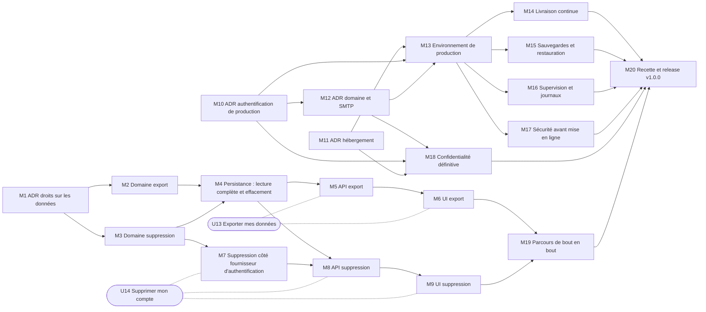

# Lot 7 : droits sur les données et mise en production

> **Statut : archive de la revue statique du 2026-11-24. Les 22 issues ont été créées sur GitHub (#142 à #163).**
> Même fonctionnement que les lots [1](lot-01-fondations.md) à [6](lot-06-historique.md). Une fois les issues créées, GitHub devient la source de vérité.

Métadonnées communes : Epic `Mise en production` (à créer dans le projet), jalon `v1.0.0 - MVP`, statut initial `New`. Modules : `users` et `strength` pour les droits sur les données ; transverse pour la mise en production.

## Grille de revue statique (à appliquer à chaque issue)

Type de revue proposé : **walkthrough** (l'auteur présente, le relecteur interroge).

| # | Critère | Question à se poser |
|---|---|---|
| 1 | Clarté | Le titre et la description sont-ils compréhensibles sans contexte ? Y a-t-il des termes ambigus ? |
| 2 | Valeur | Pourquoi cette issue existe-t-elle ? Quel besoin ou quel risque traite-t-elle ? |
| 3 | Critères d'acceptation | Sont-ils vérifiables de façon objective (Given/When/Then ou liste) ? |
| 4 | Testabilité | Peut-on écrire le test avant le code ? |
| 5 | Taille (INVEST) | Indépendante, négociable, valuable, estimable, **petite**, testable ? |
| 6 | Dépendances | Sont-elles explicites et sans cycle ? |
| 7 | Cohérence | Respecte-t-elle les ADR et le glossaire ? Impose-t-elle un nouvel ADR ? |
| 8 | Périmètre | Le « hors périmètre » est-il explicite ? |

## Définition de terminé (commune)

- Tests écrits **avant** le code (TDD outside-in), et verts (pour les issues de code).
- `CLAUDE.md` et la documentation concernée mis à jour.
- ADR créé ou complété si une décision est prise ; les **prix et offres** relevés sont datés et sourcés dans `docs/analyses/`.
- Aucun secret dans le dépôt (public) ; les secrets de production vivent dans le service d'hébergement.
- Commits en anglais, préfixés par un gitmoji ; branche `feature/issue-<n>/<description-en-anglais>`.

## Rappel du périmètre

Ce lot ferme le MVP (`v1.0.0`) en deux volets.

**Droits sur les données (RGPD)** : l'utilisateur peut **exporter** toutes ses données en un fichier JSON et **supprimer son compte** de façon immédiate et définitive, y compris chez le fournisseur d'authentification.

**Mise en production** : choisir et confirmer les services (authentification de production, hébergeur, domaine, envoi d'e-mails), déployer, automatiser la livraison, sauvegarder, superviser, publier la politique de confidentialité définitive, puis livrer la version `v1.0.0`.

Décisions déjà prises :
- export en **JSON complet** (profil, séances, séries, ressentis, notes) ;
- suppression **immédiate et définitive** après confirmation ;
- les choix encore ouverts (authentification de production, hébergeur, domaine, SMTP) sont traités par des **issues de décision** avec comparaison des prix **du jour**, avant les issues de mise en place ;
- le lot inclut **sauvegardes**, **supervision et journaux**, **livraison continue** et la **page de confidentialité définitive** ;
- budget visé : 20 à 25 € par mois au plus, hébergement en Europe ([ADR-0008](../adr/0008-hebergement-preselection.md) à confirmer).

**Hors lot** : fonctionnement hors ligne, client Flutter, modèle économique, interface d'administration, haute disponibilité et mise à l'échelle (le MVP vise des centaines d'utilisateurs), avis juridique professionnel.

## Structure du découpage

Dépendances externes : #68 (back-end), #69 (PWA), #70 (contrat OpenAPI), #71 (pile locale), #72 (spike jeton Supabase), #73 (intégration continue), #89 à #91 (identité, utilisateur interne, sécurité de l'API), #93 et #94 (connexion et session), #96 et #97 (profil), #100 (page provisoire de confidentialité), #101 et #103 (séances), #112 à #114 (exécution), #126 à #130 (historique), #141 (parcours du lot 6). Les ADR [0006](../adr/0006-postgresql-spring-data-jdbc.md), [0007](../adr/0007-authentification-supabase.md) et [0008](../adr/0008-hebergement-preselection.md) sont complétés par ce lot, jamais réécrits.

---

## M1 (#142) : Définir le modèle des droits sur les données

**Label** : `Technical Recit` · Priority 🏔 High · Size 🐇 Small

**Contexte.** Exporter et supprimer des données traverse plusieurs modules et un service externe. Sans règle commune, un module peut être oublié (donnée orpheline) ou l'ordre des opérations laisser un compte à moitié supprimé.

**À faire**
- Rédiger un **ADR** qui fixe :
  - le **périmètre de l'export** : toutes les données de l'utilisateur (profil, séances terminées, en cours et prévues, séries, ressentis, notes) ; le catalogue d'exercices, commun à tous, n'est pas exporté mais chaque exercice est référencé par son identifiant et son nom ;
  - le **format** : un fichier JSON, versionné (`schemaVersion`), généré à la demande, dates en ISO 8601 UTC, unités telles que saisies ;
  - le mécanisme **modulaire** : chaque module expose un port de sortie pour fournir ses données et un autre pour les effacer, un cas d'usage transverse les orchestre (aucun module n'accède aux tables d'un autre, ADR-0005) ;
  - la **suppression** : confirmation explicite, session récente exigée, puis effacement dans un ordre défini, **idempotent** et relançable ; la suppression chez le fournisseur d'authentification vient en dernier, l'utilisateur interne n'étant retiré qu'une fois celle-ci faite ;
  - le **traitement d'un échec** à mi-parcours (utilisateur marqué « en cours de suppression », reprise possible, jamais d'accès aux données entre-temps) ;
  - ce qui est **journalisé** (le fait d'un export ou d'une suppression, sans donnée personnelle) ;
  - les **sauvegardes** : durée de rétention et effet d'une suppression sur elles, à documenter dans la politique de confidentialité.

**Critères d'acceptation**
- *Given* l'ADR publié, *When* je le lis, *Then* je peux écrire les domaines de M2 et M3 sans autre question.
- *Given* un échec du fournisseur d'authentification pendant la suppression, *Then* l'ADR précise l'état du compte et comment la suppression est reprise.
- *Given* une nouvelle fonctionnalité qui stocke des données, *Then* l'ADR précise comment elle s'ajoute à l'export et à la suppression.

**Hors périmètre.** Code, interface.

**Dépendances.** #90, #126. **ADR liés.** 0005, 0007, 0011.

---

## M2 (#143) : Domaine de l'export des données

**Label** : `Technical Recit` · Priority 🏔 High · Size 🐂 Medium

**Contexte.** Le cas d'usage d'export rassemble les données de chaque module selon l'ADR de M1.

**À faire**
- Écrire en TDD le cas d'usage transverse et les ports de sortie des modules `users` et `strength` ; le document produit est un modèle de domaine indépendant du JSON.
- Étendre les adaptateurs en mémoire existants.

**Critères d'acceptation**
- *Given* un utilisateur avec un profil, des séances terminées et une séance en cours, *When* j'exporte, *Then* le document contient tout cela, rattaché à cet utilisateur seul.
- *Given* un utilisateur sans aucune séance, *Then* l'export contient le profil et des listes vides.
- *Given* les données d'un autre utilisateur, *Then* elles n'apparaissent jamais dans l'export.
- *Given* le document, *Then* il porte un numéro de version de schéma et la date de génération.
- Un test ArchUnit confirme que le domaine reste indépendant du cadre.

**Hors périmètre.** Sérialisation JSON, API, persistance.

**Dépendances.** M1, #113. **ADR liés.** 0005, 0010, 0011.

---

## M3 (#144) : Domaine de la suppression de compte

**Label** : `Technical Recit` · Priority 🏔 High · Size 🐂 Medium

**À faire**
- Écrire en TDD le cas d'usage transverse : marquer l'utilisateur « en cours de suppression », effacer les données de chaque module (port de sortie dédié), supprimer l'identité chez le fournisseur (port de sortie), puis retirer l'utilisateur interne.
- Garantir l'**idempotence** : relancer après un échec reprend là où il s'est arrêté.
- Étendre les adaptateurs en mémoire existants.

**Critères d'acceptation**
- *Given* un utilisateur avec des données, *When* je supprime son compte, *Then* plus aucune donnée ne lui est rattachée et son identité est supprimée.
- *Given* un échec de la suppression chez le fournisseur, *Then* l'utilisateur reste marqué « en cours de suppression », ses données restent inaccessibles et une nouvelle tentative aboutit.
- *Given* une suppression déjà terminée, *When* je la relance, *Then* le résultat est le même, sans erreur.
- *Given* deux utilisateurs, *When* j'en supprime un, *Then* les données de l'autre sont intactes.
- Un test ArchUnit confirme que le domaine reste indépendant du cadre.

**Hors périmètre.** Persistance, appel au fournisseur réel, API.

**Dépendances.** M1, #113. **ADR liés.** 0005, 0010, 0011.

---

## M4 (#145) : Persistance des droits : lecture complète et effacement

**Label** : `Technical Recit` · Priority 🏔 High · Size 🐂 Medium

**À faire**
- Implémenter en TDD (Testcontainers, ADR-0010) les adaptateurs PostgreSQL des ports de M2 et M3 pour `users` et `strength`.
- Ajouter, par migration Liquibase, l'état « en cours de suppression » et les contraintes nécessaires à un effacement complet (clés étrangères avec suppression en cascade là où le modèle le justifie).
- Vérifier qu'**aucune table** contenant l'identifiant de l'utilisateur n'est oubliée (test qui parcourt le schéma).

**Critères d'acceptation**
- *Given* une base avec deux utilisateurs, *When* j'efface le premier, *Then* ses lignes ont disparu de **toutes** les tables et celles du second sont intactes.
- *Given* une nouvelle table ajoutée avec une référence à l'utilisateur sans prise en charge de l'effacement, *Then* le test de schéma échoue.
- *Given* un utilisateur en cours de suppression, *Then* ses données ne sont plus lisibles par les cas d'usage normaux.
- La migration s'applique sur une base existante sans perte.

**Hors périmètre.** API, fournisseur d'authentification.

**Dépendances.** M2, M3, #103, #114. **ADR liés.** 0006, 0010.

---

## U13 (#146) : Exporter mes données

**Label** : `Enhancement` · Priority 🏔 High · Size 🐂 Medium

**En tant qu'** utilisateur, **je veux** télécharger toutes mes données dans un fichier, **afin de** les conserver ou de les réutiliser ailleurs.

**Critères d'acceptation**
- *Given* mon profil, *When* je demande l'export, *Then* je télécharge un fichier JSON contenant mes séances, séries, ressentis et notes.
- *Given* le fichier, *Then* il est lisible par un humain (indenté) et nomme le jeu de données et sa version.
- *Given* un compte avec beaucoup de séances, *Then* l'export aboutit sans bloquer l'application.
- *Given* une demande répétée à la suite, *Then* elle est limitée avec un message explicite.

**Sous-issues techniques** : M5, M6.

**Dépendances.** M4.

---

## M5 (#147) : API d'export

**Label** : `Technical Recit` (sous-issue de U13) · Priority 🏔 High · Size 🐇 Small

**À faire**
- Compléter le **contrat OpenAPI d'abord** (#70) : téléchargement du fichier d'export de l'utilisateur courant.
- Écrire en TDD l'adaptateur REST, l'en-tête de téléchargement (nom de fichier daté) et la limitation de fréquence.

**Critères d'acceptation**
- *Given* un utilisateur connecté, *When* je demande l'export, *Then* la réponse est 200 avec un JSON conforme au contrat.
- *Given* aucun jeton, *Then* 401.
- *Given* deux demandes en moins d'une minute, *Then* la seconde est refusée (429) avec le délai d'attente.
- *Given* la réponse, *Then* elle n'est pas conservée par un cache partagé (en-têtes adaptés).
- Les réponses respectent le contrat (test de contrat).

**Dépendances.** M4, #70, #91.

---

## M6 (#148) : Interface d'export

**Label** : `Technical Recit` (sous-issue de U13) · Priority 🏔 High · Size 🐇 Small

**À faire**
- Écrire en TDD, dans l'écran du profil (#97), l'action « Exporter mes données » avec explication de son contenu, retour d'avancement et gestion des erreurs.

**Critères d'acceptation**
- *Given* le profil, *When* je choisis l'export, *Then* le navigateur télécharge le fichier.
- *Given* une limitation de fréquence, *Then* un message m'indique quand réessayer.
- *Given* une erreur réseau, *Then* un message l'indique et je peux recommencer.

**Dépendances.** M5, #97.

---

## M7 (#149) : Suppression de l'identité chez le fournisseur d'authentification

**Label** : `Technical Recit` (sous-issue de U14) · Priority 🏔 High · Size 🐂 Medium

**Contexte.** Supprimer un utilisateur Supabase demande l'API d'administration, qui exige une clé à privilèges élevés. Ce secret ne doit exister que côté serveur.

**À faire**
- Implémenter en TDD l'adaptateur du port de M3 : appel à l'API d'administration du fournisseur, avec test d'intégration contre la pile locale (#71).
- Ranger la clé d'administration dans la configuration par variable d'environnement, jamais dans le dépôt ni dans la PWA.
- Traiter proprement un utilisateur déjà absent chez le fournisseur (succès).

**Critères d'acceptation**
- *Given* un compte chez le fournisseur local, *When* je le supprime via l'adaptateur, *Then* la connexion avec ces identifiants échoue ensuite.
- *Given* un compte déjà supprimé, *Then* l'appel réussit sans erreur.
- *Given* une panne du fournisseur, *Then* l'adaptateur signale un échec récupérable, sans fuite de la clé dans les journaux.
- *Given* le dépôt, *Then* aucun secret n'y figure (contrôle automatisé de #77).

**Hors périmètre.** Choix du fournisseur de production (M10).

**Dépendances.** M3, #71, #72. **ADR liés.** 0007.

---

## U14 (#150) : Supprimer mon compte

**Label** : `Enhancement` · Priority 🏔 High · Size 🐂 Medium

**En tant qu'** utilisateur, **je veux** supprimer mon compte et toutes mes données, **afin de** exercer mon droit à l'effacement.

**Critères d'acceptation**
- *Given* mon profil, *When* je demande la suppression, *Then* l'application m'explique que c'est **définitif** et me propose d'exporter mes données d'abord.
- *Given* la confirmation, *When* je saisis mon adresse e-mail et valide, *Then* mon compte et mes données sont supprimés et je suis déconnecté.
- *Given* ensuite, *When* j'essaie de me reconnecter avec les mêmes identifiants, *Then* la connexion échoue.
- *Given* une session ancienne, *Then* l'application me demande de me reconnecter avant de supprimer.
- *Given* un échec en cours de route, *Then* je vois un message clair et ma demande peut être reprise.

**Sous-issues techniques** : M7, M8, M9.

**Dépendances.** M4.

---

## M8 (#151) : API de suppression de compte

**Label** : `Technical Recit` (sous-issue de U14) · Priority 🏔 High · Size 🐇 Small

**À faire**
- Compléter le **contrat OpenAPI d'abord** (#70) : suppression du compte de l'utilisateur courant, avec confirmation dans la requête.
- Écrire en TDD l'adaptateur REST, la vérification d'une **authentification récente** et la traduction des erreurs.

**Critères d'acceptation**
- *Given* une session récente et la bonne confirmation, *When* je supprime, *Then* la réponse est 204 et mes données ont disparu.
- *Given* une confirmation erronée, *Then* la réponse est une erreur de validation au format du contrat.
- *Given* un jeton émis il y a longtemps, *Then* la réponse est 403 avec un code indiquant qu'une nouvelle connexion est requise.
- *Given* aucun jeton, *Then* 401.
- *Given* un échec en cours, *When* je relance, *Then* la suppression reprend (idempotence).
- Les réponses respectent le contrat (test de contrat).

**Dépendances.** M4, M7, #70, #91.

---

## M9 (#152) : Interface de suppression de compte

**Label** : `Technical Recit` (sous-issue de U14) · Priority 🏔 High · Size 🐇 Small

**À faire**
- Écrire en TDD, dans l'écran du profil (#97), la zone « Supprimer mon compte » : explication, lien vers l'export, saisie de confirmation, état de progression, déconnexion et retour à l'accueil.
- Gérer la demande de nouvelle connexion (session trop ancienne) et les erreurs.

**Critères d'acceptation**
- *Given* le profil, *When* j'ouvre la zone de suppression, *Then* le bouton de validation reste désactivé tant que l'adresse e-mail saisie ne correspond pas.
- *Given* la suppression réussie, *Then* je suis déconnecté et ramené à l'accueil, sans donnée conservée dans le navigateur.
- *Given* une session trop ancienne, *Then* je suis invité à me reconnecter puis ramené à l'action.
- *Given* une erreur, *Then* un message clair m'invite à réessayer.

**Dépendances.** M8, #97, #94.

---

## M10 (#153) : Choisir l'authentification de production

**Label** : `Technical Recit` · Priority 🏔 High · Size 🐇 Small

**Contexte.** L'[ADR-0007](../adr/0007-authentification-supabase.md) retient Supabase Auth mais laisse ouvert le mode de production : hébergé payant, auto-hébergé ou autre. Le plan gratuit n'a ni sauvegarde ni disponibilité garantie (pause après une semaine d'inactivité).

**À faire**
- Relever **à la date du jour** les offres et prix (Supabase hébergé, auto-hébergement, solution de repli) dans une note de `docs/analyses/`, avec sources.
- Comparer coût mensuel, sauvegardes, région européenne, effort d'exploitation pour un développeur seul, et réversibilité (sortie des comptes et des mots de passe).
- Rédiger un **ADR** qui confirme ou remplace le choix de production, en complétant l'ADR-0007.

**Critères d'acceptation**
- *Given* l'ADR, *When* je le lis, *Then* le choix, son coût mensuel et son effet sur le budget de 20 à 25 € sont explicites.
- *Given* une panne ou une fermeture du service retenu, *Then* l'ADR décrit la procédure de sortie.
- *Given* les prix cités, *Then* chacun porte sa date de relevé et sa source.

**Hors périmètre.** Mise en place (M13).

**Dépendances.** #72. **ADR liés.** 0007, 0008.

---

## M11 (#154) : Confirmer l'hébergement

**Label** : `Technical Recit` · Priority 🏔 High · Size 🐇 Small

**À faire**
- Relever **à la date du jour** les offres de l'hébergeur de l'application web, de l'hébergeur du back-end et de la base PostgreSQL gérée, en Europe, avec sauvegardes (note datée dans `docs/analyses/`).
- Rédiger un **ADR** qui confirme ou remplace la présélection de l'[ADR-0008](../adr/0008-hebergement-preselection.md) et la fait passer au statut « Acceptée » : choix, coût mensuel total, région, mode de déploiement, stratégie de sortie.

**Critères d'acceptation**
- *Given* l'ADR, *Then* le coût mensuel total (web, back-end, base, authentification de M10) est chiffré et reste dans le budget ou l'écart est justifié.
- *Given* un incident de l'hébergeur, *Then* l'ADR précise comment redéployer ailleurs (conteneur standard, base restaurable).
- *Given* les prix cités, *Then* chacun porte sa date de relevé et sa source.

**Hors périmètre.** Mise en place (M13), haute disponibilité.

**Dépendances.** Aucune. **ADR liés.** 0004, 0006, 0008.

---

## M12 (#155) : Choisir le nom de domaine et l'envoi d'e-mails

**Label** : `Technical Recit` · Priority 🏔 High · Size 🐇 Small

**Contexte.** Le service d'envoi intégré de Supabase est limité (environ 2 e-mails par heure) et déconseillé en production : la vérification d'adresse et la réinitialisation de mot de passe exigent un **SMTP personnalisé**, et donc un domaine pour authentifier les messages (SPF, DKIM, DMARC).

**À faire**
- Décider du **nom de domaine** (existant ou à acheter) et du registrar ; relever les prix à la date du jour.
- Comparer des services d'envoi d'e-mails transactionnels (offre gratuite, région, délivrabilité, RGPD) et rédiger un **ADR** : domaine, service SMTP, adresse d'expédition, enregistrements DNS prévus.

**Critères d'acceptation**
- *Given* l'ADR, *Then* le domaine, le service SMTP, le coût annuel ou mensuel et l'adresse d'expédition sont fixés.
- *Given* le volume attendu (centaines d'utilisateurs), *Then* l'offre retenue le couvre avec une marge.
- *Given* les prix cités, *Then* chacun porte sa date de relevé et sa source.

**Hors périmètre.** Configuration effective (M13).

**Dépendances.** M10. **ADR liés.** 0007, 0008.

---

## M13 (#156) : Mettre en place l'environnement de production

**Label** : `Technical Recit` · Priority 🏔 High · Size 🦑 Large

**À faire**
- Créer les services choisis (M10, M11, M12) : base PostgreSQL gérée, back-end conteneurisé, hébergement de la PWA, authentification de production.
- Configurer HTTPS, le domaine, les enregistrements DNS (SPF, DKIM, DMARC), le SMTP et les **secrets** dans les services (jamais dans le dépôt).
- Configurer CORS et les URL de redirection de l'authentification pour le seul domaine de production.
- Appliquer les migrations Liquibase et le chargement du catalogue sur la base de production.
- Documenter la procédure dans `docs/` (pas à pas, reproductible).

**Critères d'acceptation**
- *Given* l'adresse de production, *When* je l'ouvre, *Then* la PWA se charge en HTTPS sans avertissement.
- *Given* un nouveau compte, *When* je m'inscris, *Then* je reçois l'e-mail de vérification depuis l'adresse du domaine, hors du dossier de courrier indésirable.
- *Given* un mot de passe oublié, *Then* l'e-mail de réinitialisation arrive et le lien fonctionne.
- *Given* le catalogue, *Then* il est présent en production.
- *Given* un autre domaine, *When* il appelle l'API depuis un navigateur, *Then* CORS le refuse.
- *Given* le dépôt, *Then* il ne contient aucun secret de production.

**Hors périmètre.** Automatisation de la livraison (M14), sauvegardes (M15), supervision (M16).

**Dépendances.** M10, M11, M12, #71, #73. **ADR liés.** 0007, 0008.

---

## M14 (#157) : Livraison continue à partir d'un tag

**Label** : `Technical Recit` · Priority 🏔 High · Size 🐂 Medium

**À faire**
- Créer le flux de livraison : un tag `vX.Y.Z` construit les artefacts (image du back-end, build de la PWA), applique les migrations Liquibase puis déploie.
- Prévoir le **retour arrière** (redéploiement de la version précédente) et la compatibilité des migrations avec la version précédente.
- Publier la release GitHub avec ses notes.

**Critères d'acceptation**
- *Given* un tag de test, *When* je le pousse, *Then* la version est déployée sans action manuelle.
- *Given* des tests en échec, *Then* aucun déploiement n'a lieu.
- *Given* une version défectueuse, *When* je déclenche le retour arrière, *Then* la version précédente est de nouveau servie.
- *Given* une migration, *Then* elle est appliquée avant le démarrage de la nouvelle version.
- *Given* les journaux du flux, *Then* aucun secret n'y apparaît.

**Hors périmètre.** Déploiement sans interruption, environnements multiples.

**Dépendances.** M13, #73. **ADR liés.** 0008, 0009.

---

## M15 (#158) : Sauvegardes et restauration

**Label** : `Technical Recit` · Priority 🏔 High · Size 🐂 Medium

**À faire**
- Mettre en place la sauvegarde automatique de la base de production selon la politique décidée (fréquence, rétention, chiffrement, région européenne).
- Documenter et **tester la restauration** sur une base vierge ; consigner la durée constatée.
- Documenter l'effet d'une suppression de compte sur les sauvegardes (voir M1) pour la politique de confidentialité.

**Critères d'acceptation**
- *Given* la production, *Then* une sauvegarde récente existe, datée de moins de 24 heures.
- *Given* une sauvegarde, *When* je la restaure sur une base vierge, *Then* l'application démarre dessus et les données sont cohérentes.
- *Given* la procédure, *Then* elle est écrite pas à pas dans `docs/` avec la durée mesurée.
- *Given* la rétention, *Then* les sauvegardes plus anciennes sont supprimées automatiquement.

**Hors périmètre.** Réplication, reprise automatique après sinistre.

**Dépendances.** M13. **ADR liés.** 0006, 0008.

---

## M16 (#159) : Supervision et journaux

**Label** : `Technical Recit` · Priority 🏕 Medium · Size 🐂 Medium

**À faire**
- Exposer un point de **santé** (application et base) sans information sensible.
- Écrire des journaux structurés, avec identifiant de corrélation, **sans donnée personnelle** (pas d'e-mail, pas de jeton, pas de contenu de note) ; test qui le vérifie.
- Mettre en place une surveillance externe simple de disponibilité avec **alerte** par e-mail.

**Critères d'acceptation**
- *Given* l'application saine, *Then* le point de santé répond 200 ; *Given* la base arrêtée, *Then* il répond en erreur.
- *Given* une requête authentifiée, *Then* ses journaux ne contiennent ni jeton, ni adresse e-mail, ni note.
- *Given* une indisponibilité de plus de cinq minutes, *Then* une alerte m'est envoyée.
- *Given* le point de santé, *Then* il est accessible sans authentification mais ne révèle ni version détaillée ni configuration.

**Hors périmètre.** Métriques avancées, traçage distribué, tableaux de bord.

**Dépendances.** M13. **ADR liés.** 0008, 0009.

---

## M17 (#160) : Sécurité avant la mise en ligne

**Label** : `Technical Recit` · Priority 🏕 Medium · Size 🐂 Medium

**À faire**
- Vérifier et configurer les en-têtes de sécurité HTTP de l'API et de la PWA (HSTS, CSP, type de contenu, cadres).
- Ajouter une **limitation de débit** sur les routes sensibles (export, suppression, profil).
- Passer en revue les dépendances (alertes Dependabot de #75) et les points de la liste OWASP ASVS pertinents pour une application de ce type ; consigner les écarts acceptés.

**Critères d'acceptation**
- *Given* la production, *When* j'analyse les en-têtes de la PWA et de l'API, *Then* les en-têtes prévus sont présents.
- *Given* trop de requêtes sur une route sensible, *Then* l'API répond 429.
- *Given* les alertes de dépendances, *Then* aucune vulnérabilité critique ou élevée n'est ouverte sans justification écrite.
- *Given* la revue, *Then* ses résultats et écarts acceptés sont consignés dans `docs/`.

**Hors périmètre.** Test d'intrusion externe.

**Dépendances.** M13, #75. **ADR liés.** 0007, 0009.

---

## M18 (#161) : Politique de confidentialité définitive et mentions légales

**Label** : `Documentation` · Priority 🏔 High · Size 🐂 Medium

**Contexte.** La page de #100 est provisoire. Avant `v1.0.0`, elle doit refléter les services réellement retenus, notamment les sous-traitants (authentification, hébergeur, base, envoi d'e-mails).

**À faire**
- Rédiger la politique définitive en français clair : données collectées, finalités, base légale, durée de conservation, **sous-traitants et pays**, sauvegardes, droits (accès, export, effacement) et moyen de les exercer, contact.
- Ajouter les **mentions légales** (éditeur, hébergeur).
- Évaluer le besoin d'un bandeau de cookies selon les traceurs réellement présents (l'objectif est de n'en avoir aucun de non essentiel).
- Remplacer la page provisoire en conservant l'internationalisation (#88).

**Critères d'acceptation**
- *Given* la page, *Then* chaque sous-traitant réellement utilisé y figure avec son rôle et son pays.
- *Given* la page, *Then* elle décrit comment exporter et supprimer ses données dans l'application.
- *Given* un visiteur non connecté, *Then* la page reste accessible depuis l'inscription et le pied de page.
- *Given* le contenu, *Then* il est **relu par le développeur** avant fusion et indique qu'il ne constitue pas un avis juridique.
- *Given* l'évaluation des cookies, *Then* sa conclusion est consignée.

**Hors périmètre.** Avis juridique professionnel, conditions générales de vente.

**Dépendances.** M10, M11, M12, #100. **ADR liés.** 0007, 0008.

---

## M19 (#162) : Parcours de bout en bout (exporter, supprimer)

**Label** : `Technical Recit` · Priority 🏕 Medium · Size 🐂 Medium

**À faire**
- Écrire en Playwright (`e2e/`) le parcours : inscription, réalisation d'une séance, export du fichier et vérification de son contenu, suppression du compte, impossibilité de se reconnecter.
- L'exécuter dans l'intégration continue sur la pile locale (#71).

**Critères d'acceptation**
- *Given* un compte neuf avec une séance terminée, *When* j'exporte, *Then* le fichier contient cette séance.
- *Given* ce compte, *When* je le supprime, *Then* je suis déconnecté et une nouvelle connexion échoue.
- *Given* le même e-mail, *When* je me réinscris, *Then* je repars d'un compte vide.
- Le parcours est exécuté dans l'intégration continue et ne dépend d'aucun état préalable.

**Hors périmètre.** Tests contre la production.

**Dépendances.** M6, M9, #141.

---

## M20 (#163) : Recette de mise en production et livraison de la `v1.0.0`

**Label** : `Technical Recit` · Priority 🏔 High · Size 🐇 Small

**À faire**
- Dérouler une **recette** sur la production : inscription avec e-mail réel, création et réalisation d'une séance, historique, correction, export, suppression, sauvegarde et restauration vérifiées, alerte testée.
- Vérifier la liste de contrôle : documentation à jour (`README`, `CLAUDE.md`, feuille de route), ADR acceptés, issues du jalon fermées ou reportées explicitement.
- Créer le tag `v1.0.0` et la release avec ses notes ; passer la feuille de route à jour.

**Critères d'acceptation**
- *Given* la liste de contrôle, *Then* chaque point est coché ou reporté avec une issue.
- *Given* le tag `v1.0.0`, *Then* la livraison de M14 déploie cette version.
- *Given* la production, *When* je rejoue le parcours complet avec un compte neuf, *Then* il aboutit sans erreur.
- *Given* la release, *Then* ses notes citent les fonctionnalités du MVP et les limites connues.

**Hors périmètre.** Communication, lancement public.

**Dépendances.** M14, M15, M16, M17, M18, M19. **ADR liés.** 0008, 0009.

---

## Décisions prises en revue

Validées le 2026-11-24 (avant rédaction) :
1. Export en **JSON complet**.
2. Suppression **immédiate et définitive**.
3. Choix de production traités par des **issues de décision** avec prix du jour.
4. Le lot inclut sauvegardes, supervision et journaux, livraison continue, page de confidentialité définitive.

## Décisions validées après relecture

Validées le 2026-11-24 :

5. **Nouvel epic** `Mise en production` et jalon existant `v1.0.0 - MVP` (même procédure que pour les epics précédents).
6. **Numérotation** : `M1` à `M20` pour les issues techniques, `U13` et `U14` pour les fonctionnalités ; les numéros GitHub remplacent ces clés à la création. Le lot compte **22 issues**, le plus gros à ce jour.
7. **Confirmation de suppression** : saisie de l'adresse e-mail et authentification récente (moins de 5 minutes, à fixer dans M1), plutôt que le mot de passe : cela marche aussi si d'autres méthodes de connexion sont ajoutées plus tard.
8. **Export synchrone** (téléchargement direct) avec limitation à une demande par minute ; une génération asynchrone n'est justifiée que si les volumes le demandent.
9. **Reprise de suppression** : l'utilisateur est marqué « en cours de suppression » et ses données deviennent inaccessibles ; la reprise est déclenchée par une nouvelle tentative de l'utilisateur ou à sa prochaine connexion, sans tâche planifiée.
10. **Ordre des travaux** : les ADR de décision (M10 à M12) peuvent démarrer **dès maintenant**, en parallèle du développement, pour que le choix des services ne bloque pas la fin du MVP. Les prix y seront relevés à leur date et à revérifier à la mise en place si l'écart est grand.
11. **M17 (sécurité)** et **M16 (supervision)** en priorité Medium : utiles avant `v1.0.0` mais le jalon peut sortir si seule la supervision minimale (point de santé et alerte) est prête.
12. **Étiquette `Documentation`** pour M18 (texte et non code), comme prévu dans la liste des labels du projet.
